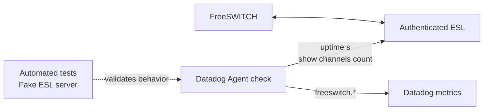

<div align="center">
  

  <p>
    
  </p>

  <p>
    <a href="lab/README.md"></a>
    <a href="integration/README.md"></a>
    <a href="docs/UPSTREAM_CONTRIBUTION.md"></a>
  </p>

  <p>
    
    
    
    
    
  </p>
</div>

<p align="center">
  
</p>

## Overview

A community **Datadog Agent integration for FreeSWITCH**, backed by a Docker lab for exercising Event Socket Library (ESL) connectivity, collection behavior, and synthetic-call scenarios.

This repository keeps the integration snapshot, lab tooling, benchmarks, and development guidance together. The integration uses a deliberately small command surface and reports operational health—not individual call records or host hardware inventory.

## What you get

<table>
  <tr>
    <td width="33%" valign="top">
      <h3>01 · Monitor</h3>
      Track ESL connectivity, FreeSWITCH uptime, and active channels with Datadog metrics.
    </td>
    <td width="33%" valign="top">
      <h3>02 · Validate</h3>
      Test configuration, protocol handling, authentication failures, and recovery with a fake ESL server.
    </td>
    <td width="33%" valign="top">
      <h3>03 · Experiment</h3>
      Use a version-pinned FreeSWITCH container, synthetic call tooling, and repeatable lab measurements.
    </td>
  </tr>
</table>

## Architecture



The check is intentionally scoped to the allowlisted ESL commands `uptime s` and `show channels count`. It does not collect CPU or memory usage, SIP registration state, RTP quality, or per-call details.

## Metrics

| Metric | Type | Description |
|---|---|---|
| `freeswitch.can_connect` | Gauge | `1` when collection succeeds; `0` when it fails |
| `freeswitch.uptime` | Gauge | FreeSWITCH uptime in seconds |
| `freeswitch.channels.active` | Gauge | Current active channels; channels are not the same as calls |
| `freeswitch.collection.duration` | Gauge | Duration of a collection run, in seconds |
| `freeswitch.collection.errors` | Count | Failed collection runs, with a bounded `error_type` tag |

**Tagging approach:** use dimensions that help operators identify the FreeSWITCH endpoint and diagnose collection failures. Error types are bounded to `connect`, `timeout`, `auth`, `protocol`, and `parse`. The integration does not add call UUIDs or phone numbers as metric tags.

## Quick start

### Validate without starting containers

Run from the repository root:

```bash
lab/tests/static-checks.sh
docker compose config -q
```

### Start and verify the lab

> **Runtime caution:** these commands can create or recreate containers. The lab's current running container may still use the legacy root `docker/freeswitch/conf` bind mount. Review the [migration procedure](docs/DEVELOPMENT.md#migrating-the-running-lab-to-labdocker) before starting the lab on an existing environment.

```bash
lab/scripts/lab-up.sh
lab/scripts/verify-lab.sh
```

Stop and remove the lab containers when you intentionally want to:

```bash
lab/scripts/lab-down.sh
```

The lab keeps ESL on a private Docker network and does not publish the ESL port to the host. Setup creates local secret material; do not commit `.env` or `secrets/`.

## Run the integration tests

The automated suite uses a fake ESL server. It does not require Docker, a running FreeSWITCH instance, or Datadog credentials. Python 3.13 is the validated test runtime.

```bash
cd integration
python3.13 -m venv .venv
source .venv/bin/activate
python -m pip install "datadog-checks-base[deps]>=37.36.0" datadog-checks-dev pytest pytest-cov
pytest tests
```

The last reported full local run completed with **181 tests passing and no expected failures**. This is a manually reported test result, not a live CI badge.

## Repository map

<table>
  <tr>
    <td width="31%"><strong><a href="lab/README.md">📦 lab/</a></strong></td>
    <td>FreeSWITCH Docker build, ESL helpers, synthetic-call tools, baseline measurements, and lab tests.</td>
  </tr>
  <tr>
    <td><strong><a href="integration/README.md">🔌 integration/</a></strong></td>
    <td>Local snapshot of the Datadog Agent check, its configuration, metrics, and tests.</td>
  </tr>
  <tr>
    <td><strong><a href="docs/ARCHITECTURE.md">🧭 docs/ARCHITECTURE.md</a></strong></td>
    <td>Component boundaries, connection paths, and metrics flow.</td>
  </tr>
  <tr>
    <td><strong><a href="docs/DEVELOPMENT.md">🛠️ docs/DEVELOPMENT.md</a></strong></td>
    <td>Development workflow, validation commands, secret handling, and lab migration.</td>
  </tr>
  <tr>
    <td><strong><a href="docs/UPSTREAM_CONTRIBUTION.md">🚀 docs/UPSTREAM_CONTRIBUTION.md</a></strong></td>
    <td>Which integration copy is authoritative, synchronization, link conventions, and upstream submission steps.</td>
  </tr>
  <tr>
    <td><strong><a href="lab/docs/">🧪 lab/docs/</a></strong></td>
    <td>Milestone reports and the integration requirements audit. Some reports preserve pre-restructure paths for historical accuracy.</td>
  </tr>
</table>

### Which copy is authoritative?

The intended upstream contribution lives in the `freeswitch/` directory of a local checkout of [DataDog/integrations-extras](https://github.com/DataDog/integrations-extras). This repository's `integration/` directory is a **synchronized snapshot**, not a second upstream project. Changes made in one location do not automatically update the other.

Before changing integration files, follow the [upstream contribution guide](docs/UPSTREAM_CONTRIBUTION.md).

## Project status

<table>
  <tr><th align="left">Area</th><th align="left">Current evidence</th></tr>
  <tr><td>Automated tests</td><td>181 passed in the last reported full local run</td></tr>
  <tr><td>Validation</td><td>Package, README, metadata, config, models, imports, dependency, style, and typos checks passed in the reported upstream checkout</td></tr>
  <tr><td>Tested platforms</td><td>macOS arm64 and Linux aarch64, Python 3.13</td></tr>
  <tr><td>Not yet tested</td><td>x86_64, other Python versions, Windows, and the container-path migration after recreation</td></tr>
  <tr><td>Live Agent exercise</td><td>Agent 7.80.3 on macOS collected from the lab through a temporary localhost forwarder</td></tr>
  <tr><td>Backend confirmation</td><td><code>freeswitch.can_connect</code> and <code>freeswitch.uptime</code> were observed in Metrics Explorer; the remaining metrics were not all independently verified there</td></tr>
</table>

The empty-host configuration defect has been fixed: empty and whitespace-only `host` values are rejected before any network connection, with regression tests.

## Security

- **Keep ESL private.** Do not expose the Event Socket on a public interface.
- **Restrict commands.** Use an ESL account limited to the commands needed by the check.
- **Keep credentials out of Git.** `.env`, `secrets/`, results, and logs must remain local.
- **Avoid sensitive tags.** Do not emit phone numbers, call UUIDs, or other per-call identifiers.

## Further reading

<p align="center">
  <a href="lab/README.md"></a>
  <a href="integration/README.md"></a>
  <a href="docs/DEVELOPMENT.md"></a>
</p>

## License

No repository-level license has been selected for this project. The integration source follows the licensing terms used by `DataDog/integrations-extras`. FreeSWITCH and any redistributed lab artifacts remain subject to their applicable upstream licenses.

<p align="center">
  
</p>
