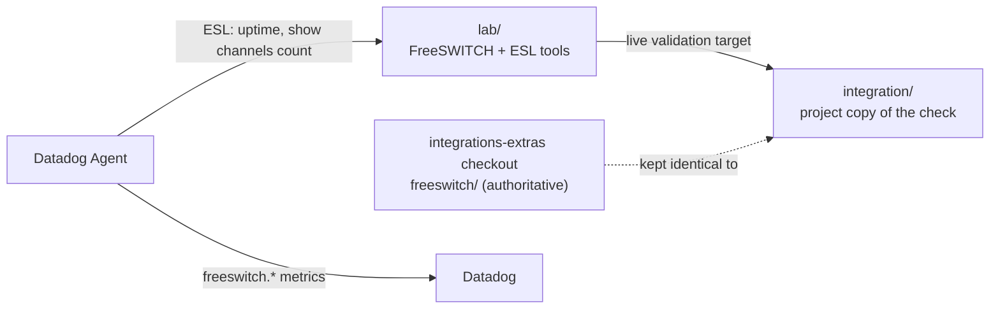

# datadog-freeswitch

A Datadog Agent integration for [FreeSWITCH](https://signalwire.com/freeswitch), and the Docker lab it is developed and
measured against.

| Component | Directory | What it is |
|---|---|---|
| FreeSWITCH Lab | [`lab/`](lab/) | A version-pinned FreeSWITCH container with a private, authenticated Event Socket (ESL), bounded synthetic-call tooling, verification scripts and baseline measurements. |
| Integration (project copy) | [`integration/`](integration/) | A snapshot of the `datadog-freeswitch` Agent check. It is a **copy** of the official contribution directory, not a separate project. |

## Which copy is authoritative?

The official contribution is the `freeswitch/` directory of a checkout of
[`DataDog/integrations-extras`](https://github.com/DataDog/integrations-extras) (branch `add-freeswitch-integration`,
currently a local branch only). `integration/` here mirrors it so the work has one visible home. **Editing `integration/`
does not change `integrations-extras`**, and the reverse is also true. Read
[`docs/UPSTREAM_CONTRIBUTION.md`](docs/UPSTREAM_CONTRIBUTION.md) before changing either.

| Repository | URL | Role |
|---|---|---|
| Official upstream | <https://github.com/DataDog/integrations-extras> | Where the integration is reviewed and merged |
| Your fork | <https://github.com/shivamsancc/integrations-extras> | Where an upstream PR branch would be pushed from |
| This project | `https://github.com/shivamsancc/datadog-freeswitch` | Lab, performance work, integration copy and docs (not publicly visible) |



## Documentation

| Document | Contents |
|---|---|
| [`lab/README.md`](lab/README.md) | The lab manual: setup, ESL access, call harness, baselines, troubleshooting |
| [`integration/README.md`](integration/README.md) | The integration: configuration, security model, metrics, connection scenarios |
| [`docs/ARCHITECTURE.md`](docs/ARCHITECTURE.md) | How lab, integration, Agent and backend relate; connection paths; metrics flow |
| [`docs/DEVELOPMENT.md`](docs/DEVELOPMENT.md) | Day-to-day workflows, test commands, secrets safety, lab path migration |
| [`docs/UPSTREAM_CONTRIBUTION.md`](docs/UPSTREAM_CONTRIBUTION.md) | The link policy, how to keep `integration/` aligned, how to prepare an upstream PR |
| [`lab/docs/`](lab/docs/) | Dated milestone reports and the requirements audit (pre-restructure paths) |

## Quick start (lab)

Run from the repository root. This starts a container; do it only when you intend to.

```shell
lab/tests/static-checks.sh     # no containers needed
lab/scripts/lab-up.sh          # first run creates .env and secrets/esl_password, builds, starts, waits for healthy
lab/scripts/verify-lab.sh      # health, ESL auth good and bad, port exposure
lab/scripts/lab-down.sh        # stop and remove containers (keeps volumes)
```

> **Not yet validated:** `docker-compose.yml` now points at `lab/docker/freeswitch`. The first `docker compose up` /
> `lab/scripts/lab-up.sh` after the reorganization has **not** been run; the lab container that is running today was
> created from the old root `docker/` path, which is deliberately still present. See
> [`docs/DEVELOPMENT.md`](docs/DEVELOPMENT.md#migrating-the-running-lab-to-labdocker) for the migration and verification
> steps.

## Integration tests

The suite uses an in-process fake ESL server and needs neither Docker, FreeSWITCH nor Datadog access. Python 3.13 is
required.

```shell
cd integration
python3.13 -m venv .venv && . .venv/bin/activate        # .venv is git-ignored
pip install "datadog-checks-base[deps]>=37.36.0" datadog-checks-dev pytest pytest-cov
pytest tests
```

Upstream-style commands (`ddev test`, lint, validation) run from the `integrations-extras` checkout; see
[`docs/DEVELOPMENT.md`](docs/DEVELOPMENT.md).

## Status

Facts as of the last run, not CI results (this repository defines no CI):

| Area | Status |
|---|---|
| Tests | 181 passed, 0 expected failures (fake ESL server; no live FreeSWITCH needed) |
| Platforms | macOS arm64 and Linux aarch64, Python 3.13; x86_64, other Python versions and Windows are untested |
| Live run | Agent 7.80.3 on macOS collected from the lab through a temporary localhost forwarder |
| Backend | `freeswitch.can_connect` and `freeswitch.uptime` were seen in Metrics Explorer; the other metrics are unverified there |
| Upstream | Not submitted. The local branch `add-freeswitch-integration` has no commits of its own: the contribution is uncommitted working-tree changes. Nothing is pushed to the fork |

**Resolved:** an empty or whitespace-only `host` is now rejected during configuration validation
(`host must not be empty`), with regression tests in `integration/tests/test_campaign.py`. The fix exists in the
`integrations-extras` working tree and in `integration/`; neither is committed.

## Security

- Never expose ESL on a public interface; the lab does not publish it at all.
- Prefer a restricted `userauth` account (`esl-allowed-api` of `uptime,show`) and the Agent's secrets management.
- `.env`, `secrets/`, `results/` and logs are git-ignored. Never paste ESL passwords or API keys anywhere.

## License

No repository-level license file is present and none has been selected; the maintainer needs to choose one.
The integration sources carry the `integrations-extras` BSD-3-Clause headers. FreeSWITCH itself is MPL 1.1 and is built
from its upstream source in the lab image.
