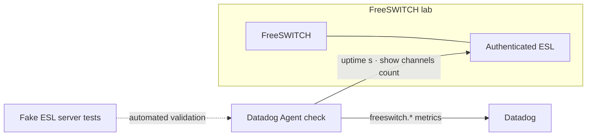

# FreeSWITCH for Datadog

**Monitor FreeSWITCH health with Datadog. Develop, validate, and benchmark the integration in a reproducible lab.**

[](https://signalwire.com/freeswitch)
[](https://github.com/DataDog/integrations-extras)
[](https://www.python.org/)
[](https://github.com/DataDog/integrations-extras)

This repository brings together the **Datadog Agent integration** and the **FreeSWITCH lab** used to exercise it. The lab provides a controlled target for testing ESL connectivity, collection behavior, and repeatable synthetic-call scenarios.

> **Project status:** Community integration under development. Unit tests and local validation have passed; the lab's latest container-path migration has not yet been verified by recreating the running container. See [current status](#project-status).

---

## At a glance

| | |
|---|---|
| **Integration** | Five health and collection metrics collected through FreeSWITCH Event Socket Library (ESL) |
| **Transport** | Authenticated ESL over a private Docker network |
| **Test strategy** | In-process fake ESL server for automated tests; Docker lab for integration and load experiments |
| **Repository layout** | Lab, integration snapshot, and project documentation are maintained separately |
| **Upstream** | Intended contribution to [DataDog/integrations-extras](https://github.com/DataDog/integrations-extras) |

## Architecture



The integration deliberately keeps its ESL command surface small. It collects health and channel-count information rather than individual call records, CPU/memory usage, or RTP quality.

## Metrics

| Metric | Meaning |
|---|---|
| `freeswitch.can_connect` | Whether the configured ESL endpoint is reachable and collection succeeds |
| `freeswitch.uptime` | FreeSWITCH uptime in seconds |
| `freeswitch.channels.active` | Active channels reported by FreeSWITCH (channels, not calls) |
| `freeswitch.collection.duration` | Time taken for a collection run, in seconds |
| `freeswitch.collection.errors` | Collection errors, categorized with bounded `error_type` values |

**Tagging principles:** keep dimensions operationally useful and low-cardinality. The integration does not tag individual calls with UUIDs or phone numbers, and it does not emit hardware metadata such as CPU model or installed RAM as FreeSWITCH metrics.

## Repository layout

| Path | Purpose |
|---|---|
| [`lab/`](lab/) | Version-pinned FreeSWITCH container, ESL helpers, synthetic-call tools, verification scripts, benchmark reports |
| [`integration/`](integration/) | Local snapshot of the Datadog integration for visibility alongside the lab |
| [`docs/`](docs/) | Architecture, development workflow, migration notes, and upstream contribution guidance |
| [`docker-compose.yml`](docker-compose.yml) | Lab Compose definition |
| [`.env.example`](.env.example) | Example environment settings; never place real secrets in source control |

### Which integration copy is authoritative?

The contribution source is the `freeswitch/` directory in the local checkout of [`DataDog/integrations-extras`](https://github.com/DataDog/integrations-extras). The `integration/` directory in this repository is a **synchronized snapshot**, not an independent upstream.

Changes to either copy do not automatically propagate to the other. Follow [the upstream contribution workflow](docs/UPSTREAM_CONTRIBUTION.md) before editing or synchronizing integration files.

| Repository | Role |
|---|---|
| [`DataDog/integrations-extras`](https://github.com/DataDog/integrations-extras) | Official upstream repository for review and merge |
| [`shivamsancc/integrations-extras`](https://github.com/shivamsancc/integrations-extras) | Personal fork used for a contribution branch when published |
| [`shivamsancc/datadog-freeswitch`](https://github.com/shivamsancc/datadog-freeswitch) | This project: lab, measurements, integration snapshot, and documentation (private repository) |

## Quick start

### 1. Validate the repository

Run from the repository root:

```bash
lab/tests/static-checks.sh
docker compose config -q
```

### 2. Start the lab

> **Runtime operation:** the following command can create or recreate containers. Review the [lab migration notes](docs/DEVELOPMENT.md#migrating-the-running-lab-to-labdocker) before running it on an environment with an existing lab.

```bash
lab/scripts/lab-up.sh
lab/scripts/verify-lab.sh
```

The lab uses a private Docker network and does not publish the ESL port to the host. Setup creates local secret material; keep `.env` and `secrets/` out of version control.

To stop the lab when you intentionally want to remove its containers:

```bash
lab/scripts/lab-down.sh
```

For the full setup, ESL configuration, test-call harness, baselines, and troubleshooting, see the [lab guide](lab/README.md).

## Run integration tests

The automated integration suite uses a fake ESL server and does not require Docker, a live FreeSWITCH instance, or Datadog credentials. Python 3.13 is the validated test runtime.

```bash
cd integration
python3.13 -m venv .venv
source .venv/bin/activate
python -m pip install "datadog-checks-base[deps]>=37.36.0" datadog-checks-dev pytest pytest-cov
pytest tests
```

For upstream-style `ddev` validation and the recommended synchronization workflow, see [Development](docs/DEVELOPMENT.md) and [Upstream contribution](docs/UPSTREAM_CONTRIBUTION.md).

## Project status

Status reflects the last reported local validation run; it is **not a claim of current CI status**.

| Area | Status |
|---|---|
| Automated tests | 181 passed; no expected failures |
| Validation | Package, README, metadata, config, model, dependency, import, EULA, style, CODEOWNERS, and typos checks passed in the upstream checkout |
| Tested platforms | macOS arm64 and Linux aarch64, Python 3.13 |
| Not yet validated | x86_64, other Python versions, Windows, and post-migration container recreation |
| Live Agent exercise | Datadog Agent 7.80.3 on macOS collected metrics from the lab through a temporary localhost forwarder |
| Backend confirmation | `freeswitch.can_connect` and `freeswitch.uptime` were observed in Metrics Explorer; other metrics were not all independently verified there |
| Upstream contribution | Not yet submitted; the contribution branch and files must be checked against the current upstream state |

The empty-host configuration defect is resolved: empty and whitespace-only `host` values are rejected before any connection attempt, with regression coverage in the integration suite.

## Security notes

- Do not expose ESL on a public interface. The lab keeps it on a private Docker network without publishing the ESL port.
- Use a restricted ESL account and allow only the commands required by the check.
- Keep `.env`, `secrets/`, `results/`, and logs out of Git.
- Never include ESL passwords, API keys, call identifiers, or phone numbers in examples, issue reports, metrics, or tags.

## Documentation

- [Lab guide](lab/README.md) — setup, ESL access, synthetic calls, baselines, troubleshooting
- [Integration README](integration/README.md) — configuration, metrics, and connection behavior
- [Architecture](docs/ARCHITECTURE.md) — components, data flow, and network paths
- [Development guide](docs/DEVELOPMENT.md) — tests, workflows, secrets safety, and lab migration
- [Upstream contribution guide](docs/UPSTREAM_CONTRIBUTION.md) — canonical source, synchronization, links, and submission workflow
- [Lab reports](lab/docs/) — milestone reports and requirements audit; historical reports may mention pre-restructure paths

## License

No repository-level license has been selected for this project. The integration source follows the licensing terms and headers used by `DataDog/integrations-extras`; the FreeSWITCH software and any redistributed lab artifacts remain subject to their applicable upstream licenses.
