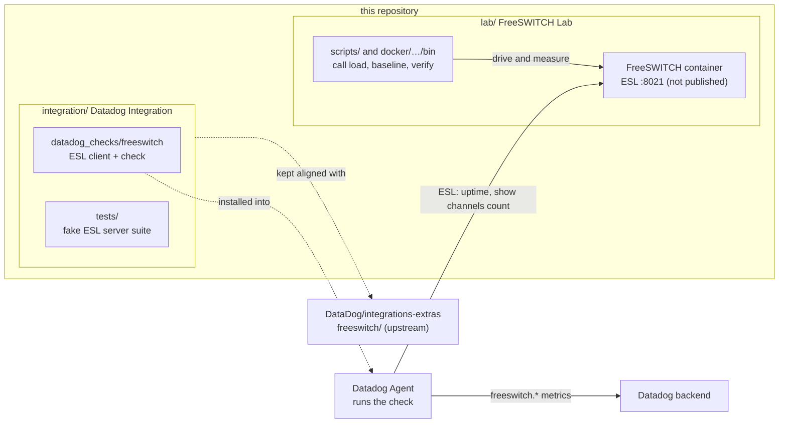

# datadog-freeswitch

Development home of a **Datadog Agent integration for FreeSWITCH** and the **Docker lab** it is developed and measured against.

| Component | Directory | What it is |
|---|---|---|
| FreeSWITCH Lab | [`lab/`](lab/) | A version-pinned FreeSWITCH container with a private, authenticated Event Socket (ESL), bounded synthetic-call tooling, verification scripts and baseline measurements. |
| Datadog Integration | [`integration/`](integration/) | The `datadog-freeswitch` Agent check: connects to ESL, runs two read-only commands, reports availability, uptime and channel count. |

> **Upstream.** The official contribution lives in the `DataDog/integrations-extras` repository under `freeswitch/`.
> `integration/` is a **maintained project copy** of that directory, not an independent implementation. See
> [Upstream contribution](#upstream-contribution-and-keeping-the-copy-aligned).

## How the pieces fit together



## Lab

The lab runs a single FreeSWITCH container built from the public release tarball. ESL is reachable only inside the private
Docker network; SIP/RTP are published on `127.0.0.1` only. The ESL password is a randomly generated file secret, never in
Git, argv or the image.

Run from the repository root:

```shell
lab/scripts/lab-up.sh          # first run creates .env and secrets/esl_password, builds, starts, waits for healthy
lab/scripts/verify-lab.sh      # health, fs_cli, ESL auth good/bad, port exposure (add --call-test for one loopback call)
lab/scripts/lab-down.sh        # stop and remove containers and network (keeps volumes)
lab/tests/static-checks.sh     # no containers needed
```

Details (configuration, call harness, measurements, troubleshooting): [`lab/README.md`](lab/README.md). Prior milestone
reports and the requirements audit: [`lab/docs/`](lab/docs/).

## Integration

The check collects over one ESL connection per instance, using only the commands `uptime s` and
`show channels count`. It never subscribes to events and has no generic command execution.

| Metric | Type | Meaning |
|---|---|---|
| `freeswitch.can_connect` | gauge | `1` if the run connected, authenticated and validated responses; `0` otherwise |
| `freeswitch.uptime` | gauge | FreeSWITCH uptime in seconds |
| `freeswitch.channels.active` | gauge | Number of channels (not calls; a bridged call is usually two or more) |
| `freeswitch.collection.duration` | gauge | Seconds one run took |
| `freeswitch.collection.errors` | count | Failed runs, tagged `error_type` (`connect`, `timeout`, `auth`, `protocol`, `parse`) |

Every metric carries `freeswitch_host` and `freeswitch_port`, plus any configured `tags`.

Minimal configuration (`conf.d/freeswitch.d/conf.yaml`); see [`integration/README.md`](integration/README.md) and
[`integration/datadog_checks/freeswitch/data/conf.yaml.example`](integration/datadog_checks/freeswitch/data/conf.yaml.example):

```yaml
init_config:

instances:
  - host: 127.0.0.1
    port: 8021
    username: datadog@monitoring.local   # optional; uses restricted `userauth`
    password: ENC[freeswitch_esl_password]
```

Without `username` the check uses the shared ESL password, which grants full control of FreeSWITCH. With `username`, the
check refuses the account unless FreeSWITCH reports its allowed API as exactly `uptime,show`.

### Running the integration tests

The suite uses an in-process fake ESL server; no FreeSWITCH or Datadog access is needed. It requires Python 3.13.

```shell
cd integration
python3.13 -m venv .venv && . .venv/bin/activate        # .venv is git-ignored
pip install "datadog-checks-base[deps]>=37.36.0" datadog-checks-dev pytest pytest-cov
pytest tests
```

Upstream-style commands (`ddev test`, lint, validation) are run from the `integrations-extras` checkout; see
[`docs/DEVELOPMENT.md`](docs/DEVELOPMENT.md).

## Connection scenarios

The check needs a `host` and `port` that the Agent process can reach. `port` selects the destination; it does not
configure FreeSWITCH. Choose exactly one path:

| Scenario | `host` / `port` | Notes |
|---|---|---|
| FreeSWITCH installed natively on the Agent host | `127.0.0.1` / ESL port | No Docker networking or forwarder. Keep `apply-inbound-acl` restrictive. |
| Docker FreeSWITCH, Agent on the Docker host: direct container IP | container IP / `8021` | Only if the host can route to the container network. Generally **not** true on Docker Desktop for macOS or Windows. Container IPs change on recreation. |
| Docker FreeSWITCH, Agent on the host: published port | `127.0.0.1` / published port | Publish on loopback, for example `-p 127.0.0.1:18021:8021`. Never `0.0.0.0` without a firewall and strong authentication. |
| Several FreeSWITCH containers | one instance each: own `host`, `port`, credentials | Containers can all use internal `8021`; use distinct host ports when sharing one host IP. |
| Optional localhost TCP forwarder | `127.0.0.1` / forwarder port | A workaround only where neither of the above fits; not an integration requirement. |
| Agent on a different host | private IP or DNS / port | Private network, firewall and ACL allowing only the Agent. Never public. |

Docker container and service names normally resolve only inside Docker networks, not from the host. Full explanations,
diagrams and examples are in [`integration/README.md`](integration/README.md#connection-architecture-and-deployment-scenarios).
The lab deliberately does **not** publish ESL, so an Agent on the host needs a published port or forwarder to reach it.

## Security notes

- Never expose ESL (plain TCP) on a public interface. Keep it on loopback or a private network behind an ACL.
- Prefer a dedicated restricted ESL user (`esl-allowed-api` = `uptime,show`) over the shared password.
- Use the Agent's secrets management (`ENC[...]`) for the password. The integration has no file-based credential option.
- No secrets in Git: `.env`, `secrets/`, `results/` and logs are ignored. Do not paste ESL passwords or API keys into
  issues, chats or CI logs.
- The lab password is a lab credential, not a production recipe.

## Testing status

Facts as of the last run; nothing here is a CI result.

| Area | Status |
|---|---|
| Unit and scenario tests | 175 passed, 1 expected failure (`xfail`, documented defect), about 95% coverage |
| Platforms where tests ran | macOS arm64 (Python 3.13) and Linux aarch64 (Python 3.13, container) |
| Not tested | x86_64, other Python versions, Windows, long-duration soak, performance claims |
| Live run against the lab | Agent 7.80.3 on macOS collected real ESL data through a temporary localhost forwarder; the Agent daemon ran the check on a 15 s schedule |
| Backend visibility | `freeswitch.can_connect` and `freeswitch.uptime` were seen in Metrics Explorer; `freeswitch.channels.active` was not visible at the time and remains unverified |
| Upstream review | Not yet merged upstream |

**Known defect (open):** an empty `host` is accepted and resolves to loopback instead of failing validation. It is
recorded for a separate implementation task; the strict `xfail` test in `integration/tests/test_campaign.py` tracks it.

No CI workflow is defined in this repository yet, so there are no CI badges or CI claims.

## Upstream contribution and keeping the copy aligned

- Upstream path: `DataDog/integrations-extras`, directory `freeswitch/`.
- Source of truth for what is submitted: the `freeswitch/` directory in your `integrations-extras` checkout.
- `integration/` here must stay a file-for-file copy of it (excluding build artifacts such as `dist/`).
- Any change intended for upstream must be made or mirrored in both places in the same working session, then compared.

The procedure and a drift-check command are in [`docs/UPSTREAM_CONTRIBUTION.md`](docs/UPSTREAM_CONTRIBUTION.md).

## Repository layout

```
.
├── README.md                this file
├── docker-compose.yml       lab Compose project (paths point into lab/)
├── .env.example             lab network settings (copy to .env; .env is ignored)
├── lab/
│   ├── README.md            detailed lab manual
│   ├── docker/freeswitch/   image build context, FreeSWITCH config, ESL tools
│   ├── scripts/             lab up/down/verify, call load, baseline
│   ├── tests/               static checks and lab unit tests
│   └── docs/                milestone reports and audits
├── integration/             project copy of integrations-extras/freeswitch/
│   ├── datadog_checks/freeswitch/
│   ├── tests/
│   ├── assets/ manifest.json metadata.csv pyproject.toml hatch.toml
│   └── README.md
└── docs/
    ├── ARCHITECTURE.md
    ├── DEVELOPMENT.md
    └── UPSTREAM_CONTRIBUTION.md
```

Git-ignored and never copied: `.env`, `secrets/`, `results/`, logs, `dist/` wheels, virtual environments.

## License

No repository-level license file is present and none has been selected; the maintainer needs to choose one.
The integration sources carry the `integrations-extras` BSD-3-Clause headers, which is the license upstream expects.
FreeSWITCH itself is MPL 1.1 and is built from its upstream source in the lab image.
