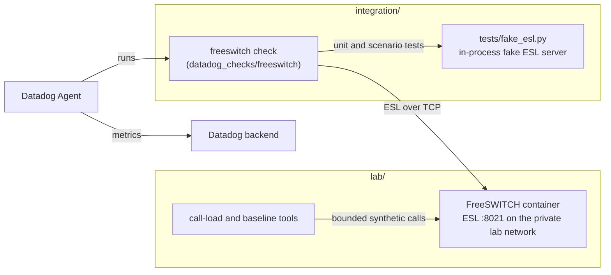

# Architecture

## Components and their relationship

- The **lab** exists to give the integration a real FreeSWITCH to talk to and to measure ESL cost and behavior under
  controlled load. It is not a deployment recipe.
- The **integration** is independent of the lab at runtime. Its automated tests use a fake ESL server and need neither
  Docker nor FreeSWITCH. The lab is used for manual and live validation.
- The lab publishes **no** ESL port. This is deliberate and is why the Docker connection scenarios below matter.

## Connection architecture

The check opens one outbound TCP connection per configured instance, authenticates (`auth <password>` or
`userauth <user@domain>:<password>`), then runs `api uptime s` and `api show channels count` each run. The connection is
reused between runs and replaced once per run if it went stale.

Reachability is the only environment-dependent part. These are alternatives, not requirements:

| Path | When it applies |
|---|---|
| `127.0.0.1:<ESL port>` | FreeSWITCH native on the Agent host |
| Container IP and `8021` | Agent on the Docker host **and** the host can route to the container network (typically native Linux Docker; generally not Docker Desktop on macOS or Windows) |
| `127.0.0.1:<published port>` | Docker publishes ESL on a loopback-only host port |
| `127.0.0.1:<forwarder port>` | A temporary or optional localhost forwarder joined to the Docker network |
| Private IP or DNS | Agent on another host, with routing and firewall rules limited to the Agent |

Docker DNS names normally resolve only inside Docker networks. Container IPs are not stable across recreation. ESL is
unencrypted; keep it on loopback or a private network behind `apply-inbound-acl`, and never public.

For the ACL: FreeSWITCH evaluates the connection's source address as it sees it. Through a published port or forwarder that
is typically the Docker gateway or the forwarder container's address, not `127.0.0.1`.

## Metrics flow

1. The Agent schedules the check (default every 15 s; a run is capped at 90% of the interval).
2. The check connects or reuses its connection and issues the two commands, bounded by `connect_timeout` and
   `read_timeout` and the 64 KiB body / 8 KiB header limits.
3. On success it emits `freeswitch.uptime`, `freeswitch.channels.active`, `freeswitch.can_connect=1`,
   `freeswitch.collection.errors=0` and `freeswitch.collection.duration`.
4. On failure it emits `can_connect=0`, `collection.errors=1` with a bounded `error_type` tag, and the duration; it emits
   no uptime or channel value for that run.
5. The Agent forwards the series to Datadog, tagged with `freeswitch_host`, `freeswitch_port` and the configured tags.

## Security boundaries

- The client has a fixed two-command allowlist; configuration cannot add commands.
- With `username`, the account must be advertised as limited to `uptime` and `show`; otherwise the run fails with
  `error_type:auth`. There is no fallback to the shared password.
- Errors and logs use fixed text; server replies, passwords and commands are never placed in tags, logs or exceptions.
- Secrets live outside Git: the lab password in `secrets/esl_password`, the Agent password via `ENC[...]`.
