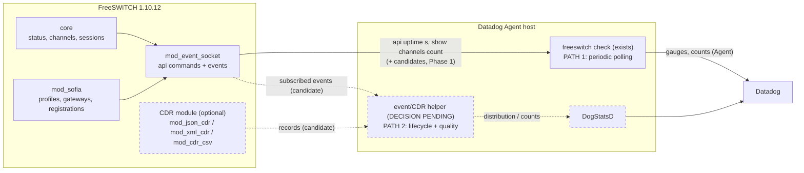
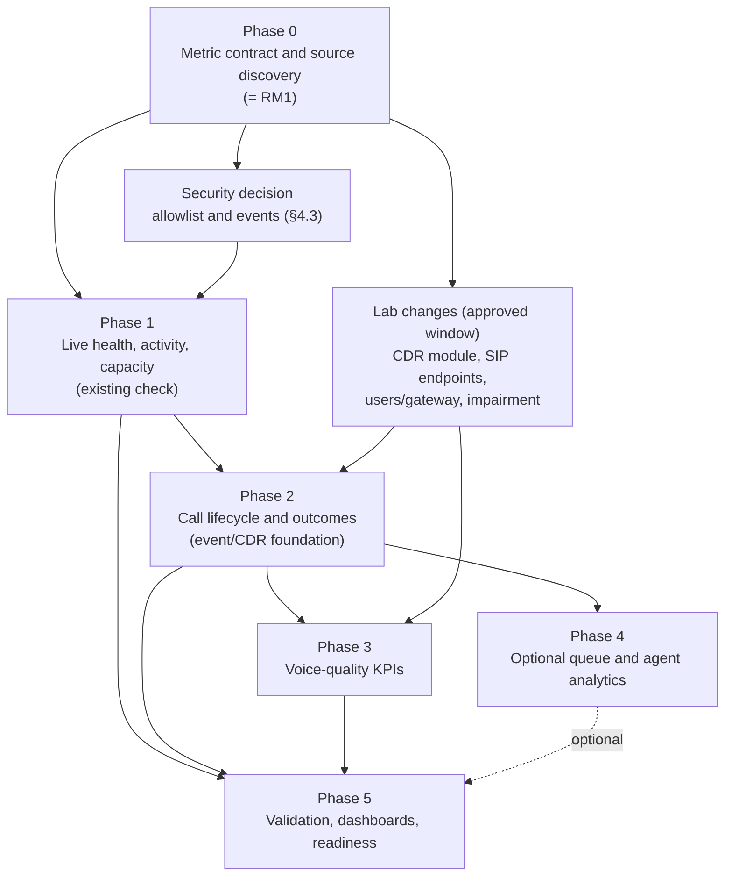

# FreeSWITCH Voice Operations Monitoring: KPI and engineering roadmap

| | |
|---|---|
| Document status | Living document. Created 2026-10-12; contract reconciled 2026-10-12 with the Session A and Session B evidence. **Implemented metrics are listed in §2.1; the §6 status columns were reconciled with the code on 2026-10-12 (final local verification). Everything else in §6 is a candidate, deferred or blocked.** |
| Current milestone | **RM1: Metric contract and local call simulation readiness** (`IN_PROGRESS`) |
| Evidence record | [evidence/RM1_T1_T2_EVIDENCE.md](evidence/RM1_T1_T2_EVIDENCE.md): inventory, captures, security review. This roadmap summarizes conclusions and does not repeat captures |
| Owner of decisions | Project maintainer (see [§9](#9-decisions-assumptions-open-questions-and-out-of-scope)) |
| Related | [ARCHITECTURE.md](ARCHITECTURE.md), [DEVELOPMENT.md](DEVELOPMENT.md), [UPSTREAM_CONTRIBUTION.md](UPSTREAM_CONTRIBUTION.md), [../lab/README.md](../lab/README.md), [../lab/docs/INTEGRATION_REQUIREMENTS_AUDIT.md](../lab/docs/INTEGRATION_REQUIREMENTS_AUDIT.md) |

> **Numbering.** The reports in `lab/docs/` use "Milestone 1..6" for the earlier lab and integration build-out. Roadmap
> milestones in this document are written **RM1, RM2, ...** to avoid confusion. RM1 is "Milestone 1" in the request that
> created this roadmap.

## Contents

1. [Vision and design principles](#1-vision-and-design-principles)
2. [Verified baseline](#2-verified-baseline)
3. [Test strategy: four evidence levels](#3-test-strategy-four-evidence-levels)
4. [Architecture and the two-collection-path decision](#4-architecture-and-the-two-collection-path-decision)
5. [Metric naming, types and cardinality policy](#5-metric-naming-types-and-cardinality-policy)
6. [KPI inventory and metric contract](#6-kpi-inventory-and-metric-contract)
7. [Phases, dependencies and acceptance criteria](#7-phases-dependencies-and-acceptance-criteria)
8. [Ownership boundary: what FreeSWITCH does not own](#8-ownership-boundary-what-freeswitch-does-not-own)
9. [Decisions, assumptions, open questions and out of scope](#9-decisions-assumptions-open-questions-and-out-of-scope)
10. [Current milestone RM1 and immediate next actions](#10-current-milestone-rm1-and-immediate-next-actions)
11. [Progress log](#11-progress-log)
12. [Sources](#12-sources)

---

## 1. Vision and design principles

Evolve the integration from "is FreeSWITCH reachable" into **FreeSWITCH Voice Operations Monitoring** that lets an
operator answer five questions:

| # | Question | Phase |
|---|---|---|
| Q1 | Is FreeSWITCH healthy and reachable? | Baseline (done), Phase 1 |
| Q2 | Are calls working, and what are their outcomes? | Phase 1 (live), Phase 2 (outcomes) |
| Q3 | Are session and call capacities approaching their limits? | Phase 1 |
| Q4 | Are SIP profiles, registrations and gateways healthy? | Phase 1 |
| Q5 | Is voice quality acceptable? | Phase 3 |

Principles:

1. **Single instance first.** Everything must be useful for one FreeSWITCH. Multi-instance support is already provided by
   Agent `instances:` and must not require anything extra.
2. **No telecom network required.** Development and automated tests use a self-contained lab; real carriers are an
   optional late validation stage ([§3](#3-test-strategy-four-evidence-levels)).
3. **Verify before approving.** A metric name is not a contract. A candidate becomes `APPROVED` only after its source
   output has been observed on FreeSWITCH 1.10.12 (or the gap is documented).
4. **No duplicate measurements.** One underlying quantity has one metric. Ratios and rates are derived in Datadog unless
   there is a stated reason to submit them.
5. **Least privilege is part of the design.** Every new ESL command or event is a change to the security model
   ([§4.3](#43-security-constraint-on-any-new-command)); it is reviewed, not just added.
6. **Bounded cardinality.** Tags are configuration-derived and bounded. Never phone numbers, call UUIDs or caller IDs.
7. **Preserve what exists.** The five baseline metrics, validation, bounded protocol handling, authentication policy,
   error taxonomy and fake-ESL tests are kept unless a change is justified in writing.
8. **Honest evidence.** Simulation proves behavior of the code against FreeSWITCH in a lab. It does not prove carrier
   behavior or real-world network quality, and no document may claim it does.

## 2. Verified baseline

Verified 2026-10-12 against `integration/` (identical to the upstream working tree `freeswitch/`), not from earlier
reports alone.

### 2.1 Implemented metrics

Status vocabulary used here and in [evidence/METRIC_VERIFICATION_REPORT.md](evidence/METRIC_VERIFICATION_REPORT.md): **runtime-verified**
= checked against a disposable FreeSWITCH 1.10.12 with real SIP calls (L2); **unit-tested** = deterministic fixtures
and fake server only (L1); **Agent-verified** = observed through a real Datadog Agent 7.80.3 (local sink, no real intake).

| Metric | Type | Unit | Source | Default | Evidence |
|---|---|---|---|---|---|
| `freeswitch.can_connect` | gauge 1/0 | none | whole run | on | runtime-verified, Agent-verified |
| `freeswitch.uptime` | gauge | second | `uptime s` | on | runtime-verified, Agent-verified |
| `freeswitch.channels.active` | gauge | none | `show channels count` | on | runtime-verified |
| `freeswitch.collection.duration` | gauge | second | monotonic time of the run | on | unit-tested; emitted under the Agent |
| `freeswitch.collection.errors` | count | error | 0 on success, 1 per distinct `error_type` on failure | on | runtime-verified (auth, refused, timeout, connect) |
| `freeswitch.sessions.active` | gauge | session | `show status`, current/peak line | on | runtime-verified (equals channels), Agent-verified |
| `freeswitch.sessions.peak` | gauge | session | same line, all-time peak since process start | on | runtime-verified (held 391 s, across 5-min boundaries) |
| `freeswitch.sessions.created` | monotonic_count | session | `show status`, `since startup`; a `0` baseline sample is submitted first after a detected restart | on | runtime-verified; restart behavior Agent-verified (24 of 24 sessions) |
| `freeswitch.sessions.limit` | gauge | session | `show status`, `max` line | on | runtime-verified |
| `freeswitch.sessions.rate.limit` | gauge | session | `show status`, rate line `out of max` | on | runtime-verified |
| `freeswitch.registrations` | gauge | none | `show registrations count` | on | runtime-verified (1, 0 after unregister, 1) |
| `freeswitch.calls.bridged` | gauge | none | `show bridged_calls count` (full listing) | **off**, `collect_bridged_calls: true` | runtime-verified when enabled (0, 1, 3, up to 150) |

- Base tags: `freeswitch_host`, `freeswitch_port`, plus configured `tags`. `error_type` is bounded to
  `connect|timeout|auth|protocol|parse`.
- Source files: [`check.py`](../integration/datadog_checks/freeswitch/check.py),
  [`esl.py`](../integration/datadog_checks/freeswitch/esl.py), [`metadata.csv`](../integration/metadata.csv).
- No service check. No event subscription. State kept between runs: one reusable connection, failure-log bookkeeping, and
  the last uptime and counter value used to detect a FreeSWITCH restart.
- **`freeswitch.channels.active` counts channels, not calls.** See [KPI-C1](#62-metric-contract-table).

### 2.2 Command surface and security (must be preserved)

| Property | Fact | Evidence |
|---|---|---|
| Client allowlist | Exactly `uptime s`, `show channels count`, `show status`, `show registrations count` and `show bridged_calls count`, matched exactly, checked before sending; the last is only sent when `collect_bridged_calls` is true | `ALLOWED_COMMANDS` in `esl.py`, `check.py` |
| Server-side restriction | `userauth` with `esl-allowed-api`; the check refuses an account unless FreeSWITCH reports exactly `uptime,show` | `_require_restricted_account` |
| Granularity limit | FreeSWITCH matches `esl-allowed-api` on the **first word** only, so `uptime,show` also admits every other `show ...` subcommand | `esl.py` comment, M4 report |
| Shared-password mode | Full control; cannot be inspected or restricted | README |
| Error text | Fixed strings; no passwords, commands or server text in exceptions or logs | `esl.py` |
| Limits | 8 KiB headers, 64 KiB body (2 MiB for the bridged listing only), per-message read timeout, whole-run deadline below the interval | `esl.py`, `check.py` |
| Config validation | Empty or whitespace `host` rejected (fixed 2026-10-12); port and timeout ranges; credentials without control characters | `validators.py`, `test_campaign.py` |

### 2.3 Tests

As of 2026-10-12 (final local verification): 316 unit and scenario tests that need no FreeSWITCH
(`test_unit.py`, `test_campaign.py`, `test_metrics.py`, driven by [`fake_esl.py`](../integration/tests/fake_esl.py)), and
15 opt-in runtime tests (`FS_RUNTIME_TESTS=1`, [`tests/runtime`](../integration/tests/runtime)) against a disposable
FreeSWITCH container that is separate from the lab. Experiments that are not tests: `restart_experiment.py` (real Agent
and restart) and `measure_bridged.py` (response size and duration). Exact commands and results are in the report.

### 2.4 The lab (what it can and cannot simulate today)

| Item | Current state | Consequence for the roadmap |
|---|---|---|
| FreeSWITCH | 1.10.12 built from source; only modules in [`modules.conf`](../lab/docker/freeswitch/modules.conf) | See next rows |
| Modules loaded | `console, logfile, event_socket, sofia, loopback, commands, dptools, dialplan_xml, tone_stream` | **No CDR module** (`mod_cdr_csv`, `mod_json_cdr`, `mod_xml_cdr`), **no `mod_callcenter`**; adding them means rebuilding the image |
| Limits | `max-sessions=200`, `sessions-per-second=30` | Capacity metrics have a known configured limit to test against |
| SIP | `internal` profile, `auth-calls=true`, `disable-register=true`; **no directory users, no gateways** | Registrations and gateway state cannot be tested without a (approved) lab configuration change |
| Calls | Synthetic calls are **loopback** calls driven by `esl-load` via ESL `originate` (extensions 9390, 93000-93120, 9197, 9198, and a nonexistent number for `NO_ROUTE_DESTINATION`) | Loopback is not SIP. One call is 4 channels, 4 sessions, 3 `show calls` rows and 1 bridged-calls row (observed). It inflates channel and `show calls` counts. The channel rows show codec `L16` at 8 kHz inside FreeSWITCH; no RTP behavior was observed (**unverified**) |
| Call scenarios | `idle`, `single`, `concurrent`, `normal`, `timeout` (`ALLOTTED_TIMEOUT`), `fail` (`NO_ROUTE_DESTINATION`) with hard safety caps (20 concurrent, 60 s hold) | A good base for outcome scenarios |
| Impairment | None | Needs a network-impairment mechanism (see [Phase 3](#phase-3-voice-quality-kpis)) |
| Running state | Container created from the legacy `docker/` path; **must not be restarted or recreated** until a separately approved window | All RM1 inspection is read-only or offline |

### 2.5 Evidence status and command-source facts

Detailed outputs, provenance and analysis are in [evidence/RM1_T1_T2_EVIDENCE.md](evidence/RM1_T1_T2_EVIDENCE.md)
(§12 idle capture, §13 security review, §13.9 Session A, §13.10 Session B). Evidence classes used there and here:
**observed** (real lab output), **source-verified** (read in FreeSWITCH source; none was available in these
sessions, so this class is empty), **inferred**, **unresolved**. Everything below was observed on FreeSWITCH
**1.10.12**, in a lab with a **loopback-only** call shape, **no restricted ESL account**, **no SIP endpoints, users
or gateways**, and using the lab's **full-control shared password** through helpers that have no allowlist (so those
sessions were read-only by command choice, not technically).

| Source | Observed result | What it does **not** show |
|---|---|---|
| `show channels count` | Count-only reply (`N total.`). 0 idle; **4** during one loopback call | Anything about logical calls or SIP calls |
| `show calls count` | Count-only when tested idle (`0 total.`); **3** during one loopback call (also 3 per call in earlier harness runs) | Loaded-state logical-call semantics; other call shapes |
| `show calls` (listing) | One loaded sample: **3 rows** = one bridged-pair entry (partner in `b_*` columns) plus two unbridged loopback channel entries | **Not** a formula for logical calls: one sample, one call shape |
| `show bridged_calls count` | Returned the **full listing** followed by `N total.`, byte-identical to `show bridged_calls` (1 row loaded; `0 total.` idle) | **Not** a verified count-only source. The idle `0 total.` could not distinguish "count" from "empty listing" |
| `status` and `show status` | Same eight lines at idle, apart from uptime (and observed identical in the loaded and later samples). Fields: `UP`, version banner, `since startup`, `peak`/`last 5min` on the sessions line, `per Sec out of max`, `max`, `min idle cpu`, `Current Stack Size/Max` | Behavior for a **restricted** `uptime,show` account (never tested); other versions; the meaning of `peak` and `last 5min` (unresolved) |
| `version short` | `1.10.12` (through the shared password; `version` is outside `uptime,show`) | Behavior for a restricted account; other versions |
| `show registrations count` | `0 total.` in this lab | That non-empty registrations can be collected or parsed: no users, registration disabled |
| `uptime s` | Integer seconds; consistent with the `UP` line | |

**Security layers (kept distinct).** (1) The integration **client allowlist**: exactly `uptime s` and
`show channels count`, enforced in code before sending. (2) The **restricted-account policy** in `userauth` mode:
the check refuses any account whose advertised `Allowed-API` is not exactly `uptime,show`; it does not apply in
shared-password mode. (3) **Server-side enforcement** by FreeSWITCH on the **first word** of a command (observed in
Milestone 4 with a temporary restricted account; exact-token versus prefix matching is unresolved). (4) The **lab
helpers** (`esl-check`, `fs-cli`, ...): no allowlist, shared full-control password, **not** technically read-only.
A command succeeding through (4) is **not** evidence that it is acceptable for (1) to (3).

**Clock caution.** Per-channel `created`/`created_epoch` values were about 1 h 44 min earlier than the harness wall
clock for the same call (cause unknown). Do not use them for timing calculations until explained.

## 3. Test strategy: four evidence levels

Every metric's contract states which levels it has been validated at. A level's result must never be reported as a
higher level's result.

| Level | Name | Needs | What it proves | What it cannot prove | Runs in CI |
|---|---|---|---|---|---|
| L1 | Unit tests with fake ESL | Python only | Parser, type, tag set, failure and recovery behavior against **scripted** text | That real FreeSWITCH emits that text | Yes (also upstream) |
| L2 | Integration against the local lab | Docker lab | The real FreeSWITCH 1.10.12 output format and semantics for local calls | Behavior on other versions, SIP carriers, real NAT, real load | No (manual or local CI) |
| L3 | Controlled RTP impairment | L2 + SIP media endpoints + impairment tool | That quality statistics respond to injected loss/jitter/delay | That a carrier's quality looks like this; absolute MOS accuracy | No |
| L4 | Optional external-carrier validation | A real trunk, explicit approval | Carrier-specific signaling and codec behavior | n/a | Never; optional |

Rules:

- **L1 + L2 are mandatory** for any metric to be `DONE`. L3 is mandatory for Phase 3 metrics. L4 is never required.
- L4 must not be a prerequisite for development or automated tests, and no L1-L3 test may contact a carrier.
- Raw outputs captured at L2 become L1 fixtures (reviewed for UUIDs and numbers before being committed).
- Compatibility claims are limited to versions actually tested (today: 1.10.12 only; 1.11.x untested, risk R10 in the audit).

## 4. Architecture and the two-collection-path decision

### 4.1 Current and target shape

Solid = exists. Dashed = candidate, not decided or implemented.

### 4.2 Decision record: one path or two

**Question.** Should the integration have (1) periodic collection for live state and (2) event/CDR collection for call
outcomes, durations and quality, and where should path 2 live?

**Verified facts that constrain the answer:**

| Fact | Evidence | Consequence |
|---|---|---|
| The Agent check API submits `gauge`, `count`, `monotonic_count`, `rate`, `histogram`, `historate`; it has **no `distribution`** method | `AgentCheck` in `datadog-checks-base` 38.4.0, checked locally | Per-call observations submitted from the check become histograms (`.avg/.median/.max/.95percentile/.count`), not distributions |
| Datadog documents that **Agent checks cannot submit distributions**; only DogStatsD or the API can | [Datadog metric types](https://docs.datadoghq.com/metrics/types/) | Real global percentiles need a path outside the check |
| `ddev validate metadata` accepts only `count`, `gauge`, `rate` as metric types in `metadata.csv` | `VALID_METRIC_TYPE` in the installed `ddev` | Histogram/distribution series need explicit documented naming of their derived series |
| A check runs on an interval, is short-lived, and has no durable queue | Agent check model; `check.py` | Counting events between runs requires a persistent subscriber or persistent records |
| ESL events are not replayed after a disconnect | ESL protocol (to be confirmed at L2) | Event-only counting loses events during gaps; CDR files do not |
| CDR is generated **per call leg**; `mod_cdr_csv` and `mod_cdr_sqlite` log only the A-leg by default; only `mod_xml_cdr` documents retry (`retries`, `delay`, `err-log-dir`) | [CDR chapter](https://developer.signalwire.com/freeswitch/integration/cdr/) | Needs an explicit leg-to-call rule and a module choice |

**Options:**

| | A. Everything in the existing check | B. Two paths, event/CDR inside the check | C. Two paths, event/CDR in an optional helper |
|---|---|---|---|
| Phase 1 (live) | Fits | Fits | Fits (check) |
| Phase 2 (outcomes) | Not possible accurately from snapshots (peaks and short calls are missed) | Needs a thread or stateful reader inside a short-lived run; unbounded-loop risk the roadmap explicitly forbids | Natural: long-lived reader, its own state and recovery |
| Phase 3 (quality) | Histogram only | Histogram only | True distributions via DogStatsD possible |
| Failure recovery | Simple | Hard (state lost on Agent restart or check reschedule) | Explicit (checkpoint file, CDR spool) |
| Security surface | Grows the check's command set only | Adds event subscription to the check | Separate credentials/permissions for the helper; the check stays read-only polling |
| Upstream fit | Easy to review | Hard to review | Helper is probably out of scope for `integrations-extras`; would be a separate project artifact |
| Operational cost | One thing to deploy | One thing to deploy | Two things to deploy and monitor |

**Recommendation (provisional, not an approval):** keep **path 1 in the existing check** for everything pollable, and
treat **path 2 as an optional, separately testable helper (option C)** if Phase 2 spike evidence (RM2) confirms that
outcome metrics cannot be built from snapshots. Rationale: accuracy of counters across restarts and gaps, true
distributions, and keeping the check's narrow security model. **No architectural migration is made until RM2 produces
evidence** (event loss behavior, CDR retry behavior, volume). The upstream check must remain valid and useful on its own.

### 4.3 Security constraint on any new command

`esl-allowed-api` is first-word matching. Consequences to resolve **before** any command is added (RM1 task T5):

- `status` (first word `status`): works through the shared password and is **outside** `uptime,show`; allowing it for a
  restricted account would also require changing the client's account-policy refusal rule. Its side-effect safety is
  not demonstrated beyond its output being read-only text in the lab.
- `show ...`: already permitted (all subcommands). **`show status` returned the same text as `status` through the
  shared password** and would add no new first word, **but it has never been run through a restricted account**.
  Until that is shown (Session C, not authorized), it is **not** an approved production command source. Success
  through the shared password is not a reason to widen the client allowlist.
- `sofia ...`: first word `sofia` would permit `sofia profile 
 restart|stop`, which the official CLI reference marks
  as service-affecting. **Adding `sofia` to the server-side allowlist grants broad control of SIP profiles.** The client's
  exact-match allowlist would still limit what *this check* sends, but a compromised credential or a client bug could
  then do more. Therefore gateway/registration state must first be sought through `show` subcommands, `status`,
  `sofia`-free sources, or events; adopting `sofia` requires an explicit, documented approval.
- Event subscription (`esl-allowed-events`) is a separate permission and a separate client capability; today the client
  "never subscribes to events".
- Any expansion keeps: exact client-side matching, `userauth` refusal unless the advertised permission set equals the
  expected set (the expected set changes with the allowlist, so the refusal logic and its tests change too), fixed error
  messages, and size limits.

## 5. Metric naming, types and cardinality policy

### 5.1 Naming

- Namespace `freeswitch.`; lowercase; dot-separated nouns; most general term first.
- Current state: `freeswitch.<noun>.<state>` (existing: `channels.active`). Configured limits: `freeswitch.<noun>.limit`
  or `.max`. Event totals: `freeswitch.<noun>.<verb-past>` or `.count` suffix only where needed for clarity.
- Units go in `metadata.csv` (`second`, `millisecond`, `percent`, `session`, `call`, ...), not in the name, except where
  Datadog convention already puts them there.
- Use a different top-level noun for each different concept: `channels` (channel legs), `sessions` (core sessions),
  `calls` (logical calls). Do not reuse a noun with a different meaning.
- Renaming or changing the meaning of a shipped metric is a breaking change; the existing five are kept.

### 5.2 Types

| Need | Type | Rule |
|---|---|---|
| Current state, configured limits, health 1/0 | `gauge` | Submit every run |
| Occurrence totals from a FreeSWITCH-side monotonically increasing counter (e.g. sessions since startup) | `monotonic_count` | The Agent computes deltas; a counter reset on restart is treated as a new baseline. Test the reset |
| Occurrence counts the check itself measures per run | `count` | Always submit 0 so the series exists (existing pattern for `collection.errors`) |
| Rates | Derive from a count in Datadog (`.as_rate()`), or `rate` only if the source is a raw counter | Document which |
| Per-call numeric observations (duration, answer time, jitter, MOS) from the **check** | `histogram` | Yields `.avg .median .max .95percentile .count` per interval **per Agent**; percentiles are not mergeable across hosts |
| Per-call numeric observations needing global percentiles | `distribution` via **DogStatsD or API only** | Possible only from a helper (option C) |

Do not promise average, min, max or percentile queries that the chosen type cannot support. Each KPI row in
[§6](#62-metric-contract-table) states the intended queries.

### 5.3 Tags

Allowed:

| Tag | Source | Bound |
|---|---|---|
| `env`, `service`, `version` | Agent unified service tagging, inherited | By configuration |
| `freeswitch_host`, `freeswitch_port` | Configuration (existing) | One per instance |
| `profile` | Sofia profile name from configuration | Number of configured profiles; **only once a metric is actually collected per profile** |
| `gateway` | Gateway name from configuration | Number of configured gateways; only for gateway metrics |
| `error_type` | Existing fixed set | 5 values |
| `outcome`, `failure_category` | Fixed vocabulary defined in Phase 2 | <= ~10 values, defined in the contract |
| `direction` (`inbound`/`outbound`) | Channel direction | 2 values; only where the metric is collected per direction |
| `queue` | Phase 4 only | Number of configured queues |

Forbidden as tags: phone numbers, caller ID, destination numbers, call/channel UUIDs, SIP Call-IDs, user names,
free-text hangup messages, raw `hangup_cause` strings **until** the cause set is shown to be bounded (use the normalized
category instead; the raw cause may be logged, never tagged, unless proven bounded and approved). Device or host
hardware metadata (`cpu_model`, `device_model`, `total_memory_gb`) never belongs in this integration; Agent host
metadata already carries host context.

### 5.4 Cardinality and cost gate

Each new metric records: number of series = (distinct tag combinations) x (derived series for its type, e.g. 5 for a
histogram). The Phase 5 cost review must total this for a reference deployment, and any metric whose series count
depends on call volume or user data is rejected.

## 6. KPI inventory and metric contract

> **Reconciled 2026-10-12 (final local verification).** The Impl. column below matches the code. Where a row's
> prose still says "candidate" or quotes a pre-implementation plan, the **Impl.** cell and
> [evidence/METRIC_VERIFICATION_REPORT.md](evidence/METRIC_VERIFICATION_REPORT.md) are authoritative. C1, C2, C4, C5
> (limit only), C6, C7 (bridged form only), C8 are implemented; C9 to C11 and E1 to E3 are blocked or deferred with evidence.

### 6.1 Status vocabulary

| Status | Meaning |
|---|---|
| `NOT_STARTED` | Nothing done |
| `IN_PROGRESS` | Being specified or implemented now |
| `BLOCKED` | Cannot proceed; reason recorded |
| `DONE` | Implemented **and** the evidence required by the phase acceptance criteria exists |
| `DEFERRED` | Intentionally postponed or rejected for now; reason recorded |

Two separate fields are used in the table below so a candidate is never mistaken for an implemented metric:

- **Contract**: `CANDIDATE` (name is a proposal), `VERIFIED_SOURCE` (output observed at L2), `APPROVED` (semantics, type,
  tags and tests agreed), `REJECTED`.
- **Implementation**: one of the statuses above. Only `DONE` means shipped and tested.

### 6.2 Metric contract table

"Source exists in lab 1.10.12" is one of: **Yes (observed)** (output captured in a lab report), **Documented** (official
docs name it, not observed here), **Unverified**, **No** (lab cannot produce it today).

| ID | Proposed metric | Definition | Type, unit | Source | Exists in lab 1.10.12 | Aggregation / reset | Tags, cardinality | Polling vs event | Local test | Confidence and gaps | Contract | Impl. |
|---|---|---|---|---|---|---|---|---|---|---|---|---|
| **Baseline** | | | | | | | | | | | | |
| B1 | `freeswitch.can_connect` | Connected, authenticated and parsed this run | gauge 1/0 | whole run | Yes (observed) | per run | base | polling | L1 + L2 | High | APPROVED | DONE |
| B2 | `freeswitch.uptime` | Seconds since start | gauge, second | `uptime s` | Yes (observed) | drops on restart | base | polling | L1 + L2 | High | APPROVED | DONE |
| B3 | `freeswitch.channels.active` | Channels (legs) existing now | gauge | `show channels count` | Yes (observed: 0 idle, 4 for one loopback call, count-only reply) | instantaneous | base | polling | L1 + L2 | High. **Retained as the active-channel metric.** Not calls, not sessions | APPROVED | DONE |
| B4 | `freeswitch.collection.duration` | Run time | gauge, second | monotonic | n/a | per run | base | polling | L1 | High | APPROVED | DONE |
| B5 | `freeswitch.collection.errors` | Failed runs | count | check | n/a | per run | base + `error_type` | polling | L1 | High | APPROVED | DONE |
| **Phase 1: live state and capacity** | | | | | | | | | | | | |
| C1 | `freeswitch.sessions.active` | Core sessions now | gauge | `status`/`show status` sessions line | Yes (observed: equal to channels in every steady sample, 4 and 4 under one loopback call; 7 of 172 setup/teardown samples in the 2026-10-11 data differed) | instantaneous | base | polling | L1 + L2 | **Not recommended.** Duplicates B3 on all current evidence; equality is shown **only for loopback**, and one session is not proven to be one channel for SIP calls, failed originates or other workloads. Revisit only with SIP evidence of divergence at rest | APPROVED | DONE (runtime-verified; reverses DEC-7 on 2026-10-12: it is the core session counter, and equality with channels held in every loaded sample) |
| C2 | `freeswitch.sessions.limit` | Maximum concurrent sessions FreeSWITCH reports (`max-sessions`) | gauge, session | `show status`, line `N session(s) max` (the integration's third allowlisted command) | Yes (observed: `200` at idle, loaded and +5.6 min with the shared password; `200` for the restricted `uptime,show` account in Session C) | constant until reconfiguration and restart | base | polling | L1 (parser, malformed, failure isolation) + L2 (restricted account, Session C) | **Implemented 2026-10-12.** Tested scope: FreeSWITCH 1.10.12 only. Strict parser: exactly one valid line, non-negative ASCII integer. A failure of the query omits the metric and is reported via `collection.errors`/`error_type` without affecting `can_connect` | APPROVED | DONE (runtime-verified) |
| C3 | Capacity utilization | `channels.active / sessions.limit` | derived | Datadog formula | n/a | n/a | n/a | n/a | Dashboard/monitor query test | Depends on C2. Derive in Datadog. **Do not** submit a second metric for the same ratio unless a reason is recorded. The ratio is sound for loopback; equality of sessions and channels is unproven for SIP | CANDIDATE (derived) | NOT_STARTED |
| C4 | `freeswitch.sessions.created` | Cumulative sessions created since the current FreeSWITCH process started (includes sessions of failed originates) | **monotonic_count** of the running total, session (was a gauge; changed 2026-10-12) | `show status`, line `N session(s) since startup` | Yes (observed: +4 for one loopback call; unchanged afterwards; +2 per failed originate and a decrease only across restarts in the 2026-10-11 data; `4` for the restricted account in Session C) | cumulative; resets to a low value on FreeSWITCH restart; **not** a rate or interval count (use `diff`/`per_second` in Datadog) | base | polling | L1 + L2 (restricted account, Session C) | **Implemented as a `monotonic_count`** (first as a gauge; changed after the restart experiment: see the report §3). Same parser, scope and failure isolation as C2. Restart handling was measured with a real Agent against a disposable FreeSWITCH, including the case where the new process passes the old count before the first sample, which plain monotonic_count undercounts; the check now submits a `0` baseline sample after a detected restart | APPROVED | DONE (runtime-verified, Agent-verified restart handling; type is monotonic_count, not gauge: the earlier gauge decision is superseded) |
| C5 | `freeswitch.sessions.rate` + `.rate.limit` | Current sessions-per-second and its configured limit | gauge | `status` line `N session(s) per Sec out of max M, peak P, last 5min Q` | Partly: limit `30` observed (matches config); the current value was `0` at every sample (the call's four sessions were created inside one second, between samples); its `peak` and `last 5min` semantics unresolved | instantaneous | base | polling | L2 | Low. **Deferred** until `peak`/`last 5min` are understood and a sampling approach that can see sub-interval rates exists. The limit alone is a constant | APPROVED (limit only) | PARTIAL: `sessions.rate.limit` DONE and runtime-verified; current rate and `last 5min` DEFERRED (5-min figures reset on fixed boundaries; the current rate is a one-second sample) |
| C6 | `freeswitch.sessions.peak` | Peak concurrent sessions | gauge | `status` line `peak P` | Yes (observed: `0` idle, `4` active, `4` after, `4` at +5 min 35 s) | **Unresolved.** Outlived a 5 min 35 s observation, so it is **not** the 5-minute window; consistent with all-time-since-start but **not proven** (no reset or window boundary observed) | base | polling | L2 | Low. **Deferred.** Never describe as rolling or all-time until a reset/window test exists. Do not expose `last 5min` as a metric: its sessions-line and rate-line values behaved differently | APPROVED | DONE as all-time peak (runtime-verified: held across 5-min boundaries and a later smaller call); `last 5min` NOT exposed |
| C7 | `freeswitch.calls.active` (or `.bridged`) | Logical calls in progress | gauge | evaluated: `show channels count`, `status` sessions, `show calls count`/`show calls`, `show bridged_calls` | Observed for one loopback call: channels 4, sessions 4, `show calls` rows 3, bridged-call rows 1; **none is shown to be a logical-call counter** | instantaneous | base (optionally `direction`) | polling | L2 with **SIP** calls (loopback distorts) | Low. **Deferred** until an adequate source and definition exist. `show bridged_calls count` is **not** a verified count-only source (full listing returned), so a count would need bounded parsing of rows that carry UUIDs and caller fields. Do not infer calls from channel counts or `show calls` rows | CANDIDATE (logical calls) | `calls.bridged` DONE, opt-in, runtime-verified; logical call count BLOCKED: `show calls count` equals channels minus bridged pairs |
| C8 | `freeswitch.registrations` | Registered endpoints (per profile) | gauge | candidate: `show registrations count` | **Empty only**: `0 total.` observed; lab has `disable-register=true` and no users | instantaneous | base + `profile` | polling | L2 after an approved lab config with test users | Low. **Not validated**: an empty result cannot show that non-empty rows or counts parse. Row format unobserved | APPROVED | DONE (runtime-verified with a real registration) |
| C9 | `freeswitch.gateway.up` | 1 if the gateway is in a healthy state for its type | gauge 1/0 | candidates: `sofia status gateway` (**`sofia` first word, see §4.3**), `sofia xmlstatus`/`jsonstatus`, `sofia::gateway_state` events, `sofia_gateway_data` (reads a named gateway variable; not shown to expose state) | **No** (no gateways; no gateway command was executed) | instantaneous | base + `gateway` | polling (or event) | L2 with a local loopback-to-self gateway definition, approved config | Low. **Not validated.** Docs conflict risk: official gateway chapter says a gateway with `register=false` is marked UP when the profile loads, while the CLI may show `NOREG`. Observe at L2 before defining | CANDIDATE | BLOCKED by security decision: only `sofia` exposes gateways; no `show` subcommand does |
| C10 | Gateway registration-required handling | A gateway with `register=false` must not be unhealthy merely because it is unregistered; health = (pinging and UP) or (registering and REGED) | rule | as C9 | No | n/a | `gateway` | n/a | L1 table-driven state-mapping tests + L2 | Rule is mandatory for C9 | APPROVED (rule) | NOT_STARTED, blocked with C9; observed: `NOREG` with answered pings is `Status UP`, and `REGED` can still be DOWN for originate |
| C11 | Version metadata | FreeSWITCH version | `set_metadata` | `status` banner `(Version X ...)` or `version short` | Yes (observed: `version short` returned `1.10.12`; the banner shows `1.10.12`) | per run | n/a | polling | L1 + L2 | Low risk; not a metric. `version` is outside `uptime,show`; the banner route needs the C2/C4 source and its gates | CANDIDATE | DEFERRED (`version` is outside `uptime,show`; the `show status` banner could be used) |
| **Phase 2: call lifecycle and outcomes** | | | | | | | | | | | | |
| D1 | `freeswitch.calls.attempted` | Logical calls started | count, call | events `CHANNEL_CREATE` (originating leg) or A-leg CDRs | Events: lab has `mod_event_socket` (esl-load already subscribes). CDR: **No** module | per interval | base + `direction` | event/CDR | L1 + L2 | Medium. Leg-to-call rule required | CANDIDATE | NOT_STARTED |
| D2 | `freeswitch.calls.answered` | Calls answered | count | `CHANNEL_ANSWER` or CDR `answer` timestamp / `billsec > 0` | Events yes | per interval | base + `direction` | event/CDR | L1 + L2 | Medium. "Answered" must be defined (A-leg answered vs B-leg answered) | CANDIDATE | NOT_STARTED |
| D3 | `freeswitch.calls.failed` (tag `failure_category`) | Calls that never connected, by normalized category | count | `CHANNEL_HANGUP_COMPLETE` hangup cause, or CDR | Events yes | per interval | base + bounded `failure_category` | event/CDR | L1 + L2 (`fail` scenario already exists) | Medium. Category table must be designed and covered by tests; unknown causes map to `other` | CANDIDATE | NOT_STARTED |
| D4 | `freeswitch.calls.duration` | Duration of completed calls | histogram (check) or distribution (helper), second | CDR `billsec`/`duration` or hangup-complete variables | Events yes; CDR no | per call | base + `direction` | event/CDR | L1 + L2 | Medium. Define: billable vs total. Unanswered calls excluded from billsec | CANDIDATE | NOT_STARTED |
| D5 | `freeswitch.calls.answer_time` | Delay from start to answer | histogram/distribution, second | event timestamps or CDR (`start_stamp`, `answer_stamp`) | Events yes | per call | base + `direction` | event/CDR | L1 + L2 | Medium. Not "post-dial delay" unless defined | CANDIDATE | NOT_STARTED |
| D6 | `freeswitch.calls.concurrent.peak` | Peak concurrent calls in an interval | gauge | maintained by the event consumer, or max of C7 samples | Needs C7 or events | per interval, **resets each interval** | base | event/CDR (or sampled) | L2 `concurrent` scenario | Medium. Distinct from C6 (all-time) | CANDIDATE | NOT_STARTED |
| **Phase 3: voice quality** | | | | | | | | | | | | |
| E1 | `freeswitch.rtp.jitter` | Jitter observed on a media leg | histogram/distribution, millisecond | channel variables on hangup (`rtp_audio_in_*`) | **Unverified.** Not supported by current evidence: the only call was loopback (`L16` at 8 kHz inside FreeSWITCH) and no media statistic was captured | per media leg | base (+ `direction`) | event/CDR | L3 | Low | CANDIDATE | BLOCKED for the check (needs an event listener). Research 2026-10-12: `in_jitter_*_variance` values were noisy on clean calls (0.1 to 800) and units are undocumented: NOT suitable |
| E2 | `freeswitch.rtp.packet_loss` | Loss ratio or count on a leg | histogram/distribution, percent | `rtp_audio_in_skip_packet_count` vs `rtp_audio_in_packet_count` (names documented) | Documented, **unverified** in lab; not supported by loopback evidence | per media leg | base | event/CDR | L3 | Medium. Define the ratio and the "skip" meaning in 1.10.12 source | CANDIDATE | RESEARCH: packet counts (`in_packet_count`, `out_packet_count`) matched duration x 50 on real media; `in_jitter_loss_rate` and `in_skip_packet_count` are not packet-loss ratios (see report). Needs an event listener; not implemented |
| E3 | `freeswitch.rtp.mos` | Estimated MOS | histogram/distribution | `rtp_audio_in_mos` / `rtp_audio_in_quality_percentage` if present | **Unverified**; not supported by loopback evidence. Only community posts say MOS is derived from the packet-flaw percentage | per media leg | base | event/CDR | L3 | Low. Label as "FreeSWITCH-estimated, not ITU-T P.800 measured" in all docs | CANDIDATE | RESEARCH: `in_mos` 4.50 on clean media, 3.2 to 3.7 at 10% impairment, 1.0 to 2.1 at 30%; `nan` without media. Needs an event listener; not implemented |
| **Phase 4: optional queue/agent** | | | | | | | | | | | | |
| F1..F7 | queue depth, abandoned, agent-missed, wait time, ASA, AHT, service level | See [Phase 4](#phase-4-optional-queue-and-agent-analytics) | | `mod_callcenter` commands/events (**not built in lab**) | **No** | | `queue` | mixed | L2 after module build | Definitions first | CANDIDATE | DEFERRED |
| **Out of FreeSWITCH scope** | | | | | | | | | | | | |
| X1 | CSAT, NPS, First Call Resolution, chat/email concurrency, task expiry, recording-upload status | Owned by CRM / contact-center platform / uploader | n/a | external | n/a | | | | | See [§8](#8-ownership-boundary-what-freeswitch-does-not-own) | REJECTED (as FreeSWITCH metrics) | DEFERRED |

Notes on the table:

- C1 and B3 are equal on all current evidence. DEC-7 (keep only B3) was reversed on 2026-10-12 and `sessions.active` is
  implemented, because the core counter is cheap, is reported without the asynchronous table lag, and was requested explicitly.
- C6 (`status` peak) and D6 (peak per interval) are deliberately different metrics, and C6's own window is
  unresolved. An "all-time peak" is not a rolling-window peak.
- Observed counts for one loopback call (channels 4, sessions 4, `show calls` rows 3, bridged rows 1, harness calls 1)
  are properties of the harness's call shape, not conversion factors.
- C2 and C4 depend on the same `status`-text source. Its production use is gated by restricted-account behavior
  (§4.3, Q-1, Q-9) and by the implementation gates in the evidence report §13.7; it is **not** approved by having
  worked through the shared password.
- D1 to D5 count **logical calls**, not legs. Legs are an implementation detail of how the data arrives
  ([Phase 2](#phase-2-call-lifecycle-and-call-outcomes)).
- Per-call RTP observations (E1 to E3) are properties of **media legs of completed or running calls**, never
  server-wide instantaneous counters.

## 7. Phases, dependencies and acceptance criteria

Status of every phase today: **Phase 0 `IN_PROGRESS` (RM1 is the work item). Phases 1 to 5 `NOT_STARTED`.** No Phase 1
to 5 metric is implemented.

Each phase's acceptance criteria must all hold, with evidence linked in the [progress log](#11-progress-log), before it
is `DONE`. "Evidence" means a committed test, a captured and reviewed output, or a report in `lab/docs/`.

### Phase 0: Metric contract and source discovery

**Goal.** Know exactly what each KPI means and how FreeSWITCH exposes it. Delivered by RM1 (below).

**Dependencies.** None. Read-only.

**Deliverables.** Completed contract table for every Phase 1 candidate; a decision on C1/B3; a decision record for the
allowlist (§4.3); a synthetic-call plan; test specifications.

**Status (2026-10-12), against the criteria below.** 1: partial (rows C1 to C11 reconciled in §6.2; none is yet
`APPROVED`). 2: **not met** (sanitized excerpts exist in the evidence report and raw numbers in git-ignored `results/`,
but no committed fixture with provenance). 3: not met. 4: not met (T5 `BLOCKED` on Q-1 and Q-9). 5: partial (§10.1).
6: not met.

**Acceptance criteria.**

1. Every Phase 1 candidate has all contract fields filled and a `Contract` value of `VERIFIED_SOURCE`, `APPROVED` or
   `REJECTED`, with the observed output (or the reason it cannot be observed) recorded.
2. Observed raw outputs for each retained command are stored as L1 fixtures, covering at least idle and under-load
   cases, with UUIDs and caller details absent or redacted.
3. The smallest approved set of new live-state metrics is named, with count of added series per instance.
4. The permission-model decision for `status`, `sofia` and events is written, with the client change and the
   `userauth` refusal-rule change specified.
5. The synthetic-call strategy defines scenarios for answered, failed and concurrent calls with expected values for
   every candidate metric.
6. A test plan lists, per metric: parser tests, malformed-response tests, type/unit/tag assertions, and the L2 check.

### Phase 1: Live health, call activity and capacity

**Goal.** Improve live-state visibility with the existing ESL polling check. Answers Q1, Q3, partly Q2 and Q4.

**Dependencies.** Phase 0; the security decision; lab configuration changes only for C8/C9.

**Scope rules.**

- Keep all five existing metrics unchanged.
- At most one new ESL command per run unless the run deadline and the Phase 5 performance gate are met. The run
  budget in `check.py` assumes two commands (`connect_timeout + 2 * read_timeout`) and must be revisited for a third.
  One status-text command could supply C2 and C4 (C5 and C6 are deferred), but it is **not** approved: the command
  source (`show status` versus `status`) needs restricted-account behavior established first, and every gate in
  [evidence §13.7](evidence/RM1_T1_T2_EVIDENCE.md#137-gates-before-any-command-or-metric-is-accepted) applies
  unchanged: exact client allowlist entry, minimal server permission, account-policy compatibility, isolation of
  optional queries so an `-ERR` does not take down the existing metrics, bounded parsing, fixtures from real
  captures, restricted-account test, tag policy.
- Missing or unsupported values: **omit the metric for that run and log once at debug**; never submit 0 for "unknown".
  A value that is present but unparsable is a `parse` failure, consistent with current behavior.
- No metric derived from `show calls` row counts, channel counts or `show bridged_calls` unless call semantics are
  verified (C7). Do not assume a `count` argument is count-only (`show bridged_calls count` returned the full listing).
- Gateway health follows the C10 rule.

**Acceptance criteria.**

1. Each new metric has: `metadata.csv` row (type, unit, description, orientation), spec/README documentation, and the
   emitted type and tag set asserted by tests.
2. Parser tests for each new command: golden outputs (idle, loaded, restarted), malformed, truncated, non-UTF-8,
   oversized, `-ERR`, localized or reordered text, and values at the configured limits.
3. Counter metrics (C4) have a test for FreeSWITCH restart (value decreases) that does not produce a negative or
   spurious spike.
4. Authentication tests cover the new permission set: the check refuses an account whose advertised permissions do not
   match, and still refuses `Allowed-API: all`. The documented `esl-allowed-api` value and the README are updated
   together.
5. L2 evidence: values match an independent `fs_cli`/ESL reading within one sampling interval for idle, single,
   concurrent and failed scenarios, **and** the restricted-account case is exercised against a real `userauth`
   account (not only the fake server).
6. Run cost is measured: commands per run, run duration and added series. The run deadline remains below the interval.
7. `ddev` validation set from [UPSTREAM_CONTRIBUTION.md](UPSTREAM_CONTRIBUTION.md) passes; `integration/` matches the
   upstream tree.

### Phase 2: Call lifecycle and call outcomes

**Goal.** Provide outcome and duration metrics that snapshots cannot give. Answers Q2.

**Dependencies.** Phase 1 (tagging and allowlist work), the §4.2 decision (RM2 spike), lab changes (a CDR module and,
for realistic legs, SIP endpoints).

**Questions to resolve with evidence (RM2):**

| Topic | Question | How decided |
|---|---|---|
| Source | Events, CDR, or both | Spike comparing completeness: kill the subscriber, disconnect ESL, stop the consumer and count what is lost |
| Event loss | What happens on ESL disconnect/reconnect; are events dropped silently | Fault-injection at L2 |
| CDR failure | What happens when the consumer or POST target is down; retry and spool behavior (`mod_xml_cdr` documents `retries`, `err-log-dir`; others undocumented) | Per-module L2 test |
| Duplicates and idempotency | Key for a record; re-delivery after retry | Define key (UUID + event type or CDR leg UUID); test replay of the same record twice |
| Restarts | Counter resets and what is reported after helper, Agent or FreeSWITCH restarts | Checkpoint design + tests |
| Downtime recovery | Is a gap backfilled (CDR spool) or declared lost (events); how is the loss visible | Emit a gap/health metric either way |
| Logical call | Exactly-once counting across A and B legs, transfers, forks, loopback and originate | Written leg-to-call rule below |

**Leg-to-call rule (proposal).** A CDR or hangup event is one **leg**. A logical call is counted once, at its
originating leg: the leg whose direction is `inbound` to FreeSWITCH (or the `originate` leg for locally originated
calls), identified by `Unique-ID` with `Other-Leg-Unique-ID`/`bleg_uuid` used only to **suppress** the B-leg from the
call count and to attach the outcome. Transfers, `loopback` pairs (both ends are channels in the same server) and forked
bridges require explicit test cases before the rule is `APPROVED`. A CDR per leg is never counted as a call by itself.

**Normalized failure categories (proposal, to be tested).** `normal` (not a failure), `busy`, `no_answer`/`timeout`,
`rejected`, `unroutable` (e.g. `NO_ROUTE_DESTINATION`, `UNALLOCATED_NUMBER`), `gateway_unavailable`
(e.g. `GATEWAY_DOWN`), `media_or_internal`, `other`. The mapping from FreeSWITCH hangup causes to categories is a table
with a test that every cause string in the lab's runs maps, and unknown causes map to `other`.

**Acceptance criteria.**

1. The §4.2 decision is recorded as an approved ADR with RM2 evidence.
2. The consumer/processor is separately unit-testable: it consumes recorded events/CDR files and emits metric points
   with no network or FreeSWITCH.
3. L1: duplicates, out-of-order records, malformed records, missing fields, restart replay, and bounded memory.
4. L2: for each lab scenario (`normal`, `timeout`, `fail`, `concurrent`, and a SIP-based answered/busy/no-answer set),
   reported attempted, answered and failed counts equal the harness's own accounting exactly; any loss during induced
   disconnects is reported, not hidden.
5. A reconciliation procedure compares events and CDRs for the same run and reports differences.
6. No per-call identifier appears in any tag, log at default level, or metric name.
7. The Agent check is not turned into an event loop: it performs no unbounded or blocking event consumption.

### Phase 3: Voice-quality KPIs

**Goal.** Provide media-quality observations for calls. Answers Q5.

**Dependencies.** Phase 2 (a per-call data path), SIP media endpoints in the lab, an impairment mechanism.

**Facts and cautions.**

- RTP statistics are exposed as per-channel variables ("during and after a call"), for example
  `rtp_audio_in_packet_count`, `rtp_audio_in_skip_packet_count`, `rtp_audio_in_jitter_packet_count`, available at
  hangup through CDR or `api_hangup_hook`
  ([channel variables](https://developer.signalwire.com/freeswitch/reference/channel-variables)).
  The official page does **not** document jitter statistics values, quality percentage or MOS; the community statement
  that MOS is derived from a packet-flaw percentage is **unverified** against the 1.10.12 source.
- These are observations of a **media leg**, not server-wide counters. Aggregation is per interval over legs.
- Loopback calls probably carry no RTP; Phase 3 needs SIP calls with real RTP between a local endpoint and FreeSWITCH.
  Tooling candidates (unselected): SIPp with media, a second FreeSWITCH instance on the lab network, or a SIP user
  agent in a container. Selection is an RM-level task with a license and safety review.
- Impairment candidates (unselected): Linux `tc netem` in a network namespace or sidecar container (requires
  `NET_ADMIN`, a lab change), or an application-level RTP proxy that drops/delays packets.

**Aggregation.** Each observation is a number per leg per call. From the check: `histogram` (per-Agent percentiles).
From a helper: `distribution`. Do not claim "average MOS across all hosts" from a histogram, and do not submit a
pre-averaged value (it removes percentile and worst-call visibility).

**Acceptance criteria.**

1. For every E-metric: the exact FreeSWITCH variable or event field, its units and its validity conditions are
   confirmed from observed output **and** the 1.10.12 source or official docs; any metric whose source cannot be
   confirmed is `REJECTED`.
2. Parser and unit-conversion tests (e.g. ms vs RTP timestamp units, loss as ratio vs count).
3. L3: with no impairment, observations show negligible loss/jitter; with injected loss at a stated percentage, the
   reported loss moves in the expected direction and approximate magnitude, within a documented tolerance.
4. The documentation states that lab impairment does not reproduce carrier conditions and that the MOS is
   FreeSWITCH-estimated, not a calibrated listening-quality score.
5. Calls with no RTP (never answered, loopback, early failure) emit no quality observations rather than zeros.

### Phase 4: Optional queue and agent analytics

**Goal.** Optional contact-center visibility, never a prerequisite for the base integration.

**Gate (decision before any design).** Which queueing is used: `mod_callcenter`, `mod_fifo`, a custom dialplan, or an
external system? If the source of truth is not FreeSWITCH, these KPIs belong in [§8](#8-ownership-boundary-what-freeswitch-does-not-own),
not in this integration.

**Business definitions to be written and approved first** (no metric names or formulas before these):

| Term | Definition to specify |
|---|---|
| Queue depth | Members waiting now, excluding members being offered to agents? |
| Abandoned | Caller leaves the queue before an agent answers. Threshold for "short abandon"? |
| Agent-missed | An agent was offered and did not answer (ring-no-answer, reject). Distinct from abandoned |
| Failed carrier route | Never entered the queue; a routing/carrier failure. Distinct from both above |
| Wait time / ASA | Start (enter queue) and stop (agent answers) events; treatment of overflow and transfers |
| AHT | Explicit inclusion of talk, hold and after-call-work; the source of hold and ACW times |
| Service level | Target seconds, denominator (offered vs answered vs including abandons), interval |

Different outcomes are different metrics or different tag values of a bounded `outcome` tag. They are never merged
into one "failed" count.

**Acceptance criteria.**

1. Deployment decision and written definitions approved.
2. The lab builds the chosen module (approved change) and a scenario set produces each outcome deterministically.
3. Each KPI reconciles with the lab scenario's expected count and time to within a stated tolerance.
4. Queue and agent identifiers are bounded configuration values; no per-agent or per-caller tag unless explicitly
   approved with a cardinality review.

### Phase 5: Validation, dashboards and operational readiness

**Goal.** Make the integration trustworthy and operable.

**Deliverables and acceptance criteria.**

| Deliverable | Acceptance |
|---|---|
| Metric-contract tests | A test fails if a metric is emitted without a `metadata.csv` row, with a wrong type/unit, or with a tag outside the documented set |
| Parser and malformed-response tests | Every command and event parser has golden and hostile inputs |
| Fake-ESL failure and recovery | Each new command and event path has timeout, disconnect, auth and partial-reply tests |
| Local synthetic-call validation | A single documented command runs the scenario set and prints PASS/FAIL against expected values |
| CDR/event reconciliation | Report is reproducible and differences are explained |
| Controlled voice-quality validation | Phase 3 L3 results archived |
| Dashboard and monitor examples | JSON/templates stored in `docs/` or the integration's `assets/`, each query tested against metric names that exist; **not created in the live Datadog account as part of planning** |
| Cardinality and cost review | Series per instance totaled for a reference deployment; any metric above a stated budget is justified or removed |
| Performance and resource usage | Added commands/run, run duration, Agent CPU/memory delta and FreeSWITCH overhead measured on the lab and reported **as lab numbers**, not promises |
| Upstream readiness | Validation set passes; README, spec, `metadata.csv`, CHANGELOG and tests updated together; support email and owner confirmed |

## 8. Ownership boundary: what FreeSWITCH does not own

These must not be presented as native FreeSWITCH metrics. They can appear on a unified Datadog dashboard only when
sourced from the system of record.

| KPI | Likely source of truth | Integration route (future, separate) |
|---|---|---|
| CSAT, NPS | Survey tool / CRM | That system's Datadog integration or API |
| First Call Resolution | CRM / ticketing (needs a case-resolution definition) | Same |
| Chat and email concurrency | Contact-center / messaging platform | Same |
| Task expiry | Task-routing / workforce platform | Same |
| Recording-upload workflow status | The uploader / storage service | Its own metrics or logs |

Principle: a dashboard may combine sources, but each series keeps its own source tag/namespace.

## 9. Decisions, assumptions, open questions and out of scope

### 9.1 Decisions made

| ID | Decision | Date | Evidence |
|---|---|---|---|
| DEC-1 | Keep the five baseline metrics unchanged | 2026-10-12 | Baseline verified, §2 |
| DEC-2 | Local lab is the primary validation environment; carriers are optional L4 | 2026-10-12 | Requirement |
| DEC-3 | Use `RM<n>` for roadmap milestones | 2026-10-12 | Avoids clash with lab M1..M6 |
| DEC-4 | `host` empty/whitespace is rejected at validation | 2026-10-12 | Fixed and tested |
| DEC-5 | Gateway health must honor `register=false` (C10) | 2026-10-12 | Requirement |
| DEC-6 | Derived ratios (utilization) are computed in Datadog unless justified | 2026-10-12 | Principle 4 |
| DEC-7 | **Superseded 2026-10-12** (`sessions.active` implemented). Was: keep `freeswitch.channels.active`; do **not** add `freeswitch.sessions.active` on the current evidence (revisit with SIP evidence of divergence at rest) | 2026-10-12 | Evidence §13.10: sessions equal channels in every steady loopback sample |
| DEC-8 | Logical-call count metrics stay deferred until an adequate source and definition exist | 2026-10-12 | Evidence §13.10.5: four different counts for one harness call; `show bridged_calls count` is not count-only |
| DEC-9 | A command working through the shared password is **not** grounds to widen the client allowlist or the restricted account's permissions | 2026-10-12 | Evidence §13.1 (layers), §13.9 |
| DEC-10 | Registration, gateway and voice-quality metrics are not validated by the current lab and are not to be described as such | 2026-10-12 | Evidence §13.9, §13.10 |

### 9.2 Assumptions (each to be validated)

| ID | Assumption | Risk if wrong | Check |
|---|---|---|---|
| ASM-1 | FreeSWITCH 1.10.12 is the supported target | Output formats differ on 1.11.x | Test 1.11.x before claiming support |
| ASM-2 | The Agent can reach ESL (see ARCHITECTURE.md connection paths) | Helper/sidecar deployment differs | Existing scenarios |
| ASM-3 | One session is usually one channel | C1 duplicates B3 (if true) or is a distinct signal (if false) | Observed true for loopback (equal at steady state; 7 transient mismatches in 2026-10-11 data); **unverified for SIP** |
| ASM-4 | `status` text is parseable reliably | Brittle across versions | Observed stable on 1.10.12 across idle, loaded and +5 min states; other versions untested; golden outputs and version note still required |
| ASM-5 | SIP media endpoints can run in the lab without a carrier | Phase 3 blocked | RM1 tooling survey |

### 9.3 Unresolved questions

| ID | Question | Needed by | Owner |
|---|---|---|---|
| Q-1 | May the server-side permission set grow beyond `uptime,show` (add `status`; consider `sofia`; events)? | RM1 | Maintainer (security) |
| Q-2 | Is the target deployment single-node or clustered (affects instance tagging and Phase 2 volume)? | RM1 | Maintainer |
| Q-3 | Which queue mechanism is in use (Phase 4 gate)? | Before Phase 4 | Maintainer |
| Q-4 | Should event/CDR collection be an optional helper outside the upstream contribution (option C)? | RM2 | Maintainer |
| Q-5 | Is a CDR module approved for the lab image (rebuild + recreate window)? | RM2 | Maintainer |
| Q-6 | Are upstream reviewers open to more than five metrics in the first release, or should Phase 1 be a follow-up PR? | Before Phase 1 implementation | Maintainer + reviewers |
| Q-7 | Support email and `owner` confirmation for the manifest | Before upstream PR | Maintainer |
| Q-8 | What are the exact semantics of `peak` and `last 5min` (both lines)? Needs a bounded multi-burst and boundary-sampling session (not authorized) | Before any peak/rate metric | Maintainer approval (Session B2) |
| Q-9 | Does a restricted `uptime,show` account run `show status` and receive the same text? Is first-word matching exact-token or prefix? Needs a restricted account (lab change; not authorized) | Before C2/C4 or any new command | Maintainer approval (Session C) |
| Q-10 | Why do channel `created_epoch` values differ from the wall clock by about 1 h 44 min (and container versus FreeSWITCH uptime)? Affects any timing calculation | Before any timing-derived metric | Maintainer (separately approved read-only clock check) |
| Q-11 | SIP-call, registration and gateway evidence, and the safety and output of untested candidate commands (`sofia_count_reg`, `sofia_gateway_data`) | Before C1/C7/C8/C9 | Maintainer (lab changes, T10) |

### 9.4 Out of scope

- Implementing any metric in this roadmap task; creating dashboards or monitors; modifying the live Agent; restarting or
  recreating the lab; a private-repository license; carrier connectivity as a prerequisite; call recording content;
  transcription; per-call tracing with UUIDs in metrics; FreeSWITCH configuration management or remediation actions
  (this integration is read-only).

## 10. Current milestone RM1 and immediate next actions

### RM1: Metric contract and local call simulation readiness (`IN_PROGRESS`)

**Objectives**

1. Verify current source and metrics (done as part of this roadmap, §2; re-verify at start).
2. Confirm semantics and real output of candidate Phase 1 commands.
3. Identify the smallest safe set of new live-state metrics.
4. Define a reproducible synthetic-call strategy for answered, failed and concurrent scenarios.
5. Specify tests and acceptance criteria before implementation begins.

**Constraints.** No implementation; running lab not restarted; read-only ESL commands only; no `.env`/secret access
beyond what the existing lab tools use internally. Further live sessions (B2 for window semantics, C for restricted
accounts) and lab changes are **not authorized by this roadmap**; each needs its own explicit approval.

| # | Task | Output | Evidence required for `DONE` | Status |
|---|---|---|---|---|
| T1 | Re-verify baseline (source, tests, metadata, upstream/private copy equality) | Updated §2 if changed | Command log in progress log; evidence report §2 | `DONE` (2026-10-12) |
| T2 | Capture real output of `status`, `show channels count`, `show calls count`, `show bridged_calls count`, `show registrations count`, `version short`, `show api`-listing of `sofia`-related commands via the existing lab tools, at idle and during harness scenarios (`single`, `concurrent`) | Redacted excerpts in the evidence report; committed fixtures still to do | Raw outputs reviewed; no UUID/number leakage | `IN_PROGRESS`: captured at idle and for one loopback call; `concurrent`, failed, SIP and non-empty registrations not captured live; no committed fixture |
| T3 | Decide C1 vs B3 (do sessions and channels diverge?) | Contract rows C1/C3 updated | Output pairs from T2 | `DONE` as a decision (DEC-7): keep B3 only; revisit with SIP evidence |
| T4 | Decide C7 call-count source and whether loopback can represent calls | Contract row C7 | T2 + a documented difference between loopback and SIP | `DONE` as a decision (DEC-8): no adequate source; loopback cannot define calls; deferred |
| T5 | Write the permission-model decision (`status`, `sofia`, events) incl. required changes to `_require_restricted_account` and tests | ADR section appended here | Maintainer decision recorded (Q-1) and restricted-account behavior established (Q-9) | `BLOCKED` on Q-1 and Q-9 |
| T6 | Choose minimal Phase 1 set and series count | §6 table with `APPROVED` rows | Review | `IN_PROGRESS`: C2 and C4 are the only live-state candidates left; neither is `APPROVED` (gated by T5) |
| T7 | Survey SIP test-endpoint and impairment tooling that needs no carrier; record license, image size, safety | Short report; shortlist | Links and a smoke plan | `NOT_STARTED` |
| T8 | Specify the synthetic-call scenario matrix (expected counts/times per metric, §10.1) | Table in this file or `lab/docs/` | Reviewed | `NOT_STARTED` |
| T9 | Write per-metric test specifications (parser/malformed/type/tag/L2) | Test plan | Reviewed | `NOT_STARTED` |
| T10 | List lab changes needed (modules, users, gateway, SIP endpoint, `NET_ADMIN`) for approval | Change list with risk | Maintainer approval requested | `NOT_STARTED` |

**RM1 acceptance criteria**

1. T1 to T10 are `DONE` or explicitly `DEFERRED` with a reason.
2. Every Phase 1 candidate has a final `Contract` value.
3. Every approved metric has a test specification and an L2 expected value for each scenario in §10.1.
4. No source code, tests, metadata or lab configuration changed as part of RM1 apart from this document, fixtures and
   reports.

### 10.1 Synthetic-call strategy (to be filled by T8)

Current harness scenarios are reused where possible; **loopback is sufficient for channel/session capacity and for
failure causes that arise inside FreeSWITCH (`NO_ROUTE_DESTINATION`, `ALLOTTED_TIMEOUT`), but not for SIP signaling
outcomes or RTP quality.**

| Scenario | Today | Expected values to define | Level |
|---|---|---|---|
| Idle | `idle` | channels 0, sessions 0, created delta 0 | L2 |
| Single answered | `single` / `normal` | **Observed (one run):** channels 4, sessions 4, `show calls` rows 3, bridged rows 1, since-startup +4, harness calls 1 (answered, `NORMAL_CLEARING`, about the hold time). Loopback-shape values | L2 |
| Concurrent N | `concurrent` (cap 20) | **Observed 2026-10-11:** peak channels and sessions 4N, since-startup +4N; live rows not yet captured | L2 |
| Failed route | `fail` (`NO_ROUTE_DESTINATION`) | harness: attempted N, answered 0, failed N, category `unroutable`; **observed 2026-10-11:** channels never seen, since-startup +2 per attempt | L2 |
| Timeout | `timeout` (`ALLOTTED_TIMEOUT`) | duration = hold, cause category defined | L2 |
| Busy / no-answer / reject | **missing**: needs SIP endpoint behavior | to define | L2 (after lab change) |
| Registration / gateway up/down | **missing**: needs users and a gateway | to define | L2 (after lab change) |
| Media with impairment | **missing** | loss/jitter targets | L3 |

### 10.2 Immediate next actions (in order)

1. Maintainer reviews this reconciled roadmap and the evidence record, and answers Q-1 (permission model), Q-6 (scope
   per upstream PR), and which open evidence items, if any, to approve.
2. **Not authorized yet; each needs explicit approval:** Session B2 (peak and `last 5min` semantics, Q-8), Session C
   (restricted-account behavior of `show status`, first-word matching, Q-9), a clock check (Q-10), and lab changes for
   SIP, registrations and gateways (T10, Q-11).
3. Offline work that remains without further approvals: T7 (SIP/impairment tooling survey), T8/T9 (scenario matrix and
   test specifications using the observed values above), T10 (lab-change list for approval), and committing sanitized
   fixtures with provenance.

## 11. Progress log

| Date | Change | Evidence | Decision / note |
|---|---|---|---|
| 2026-10-12 | Roadmap created (planning only) | Baseline read from `integration/` source, tests, `metadata.csv`, lab `modules.conf`, `switch.conf.xml`, dialplan, `esl-load`/`esl_lab.py`; official docs consulted (see §12) | No code, lab or Agent change. RM1 set as current milestone |
| 2026-10-12 | Found: `AgentCheck` has no `distribution`; Datadog states Agent checks cannot submit distributions | `datadog-checks-base` 38.4.0 API; Datadog metric-types page | Affects §4.2 and §5.2: true percentiles need DogStatsD/API (helper) |
| 2026-10-12 | Found: `ddev validate metadata` accepts only `count`, `gauge`, `rate` | `VALID_METRIC_TYPE` in the installed `ddev` | Histogram series need documented derived-series naming |
| 2026-10-12 | Found: lab image has no CDR module and no `mod_callcenter`; no users/gateways; loopback-only calls | `modules.conf`, `modules.conf.xml`, `directory/default.xml`, dialplan | Phase 2/3/4 and C8/C9 need approved lab changes |
| 2026-10-12 | Found: first-word matching means `sofia` in `esl-allowed-api` would admit profile stop/restart | `esl.py` comment; official CLI reference | Recorded as a security gate (§4.3, Q-1) |
| 2026-10-12 | Empty `host` validation fixed and CI-flaky fixture timeout corrected (prior work, recorded for baseline) | `integration/tests/` (181 tests passing) | Baseline for RM1 |
| 2026-10-12 | RM1 T1 evidence inventory and offline T2 analysis of saved lab output | [evidence](evidence/RM1_T1_T2_EVIDENCE.md) §2 to §11 | Sessions equal channels at rest in loopback; call-count source unresolved |
| 2026-10-12 | Idle read-only collection (`show` family); API inventory (167 commands) | evidence §12 | Count forms for channels/calls work; `show registrations` accepted and empty |
| 2026-10-12 | Offline command-security review | evidence §13.1 to §13.8 | `show status` merits a test; `sofia_count_reg` and `sofia_gateway_data` blocked |
| 2026-10-12 | Session A: `show status`, `status`, `version short`, `show registrations count`, `show channels count`, `uptime s` at idle | evidence §13.9 | `show status` equals `status` at idle; `version short` is `1.10.12` |
| 2026-10-12 | Session B: one bounded loopback call, loaded and +5.6 min samples | evidence §13.10 | Four different counts for one call; `show bridged_calls count` is not count-only; `peak` outlived 5 min 35 s; `last 5min` decayed |
| 2026-10-12 | Roadmap contract reconciled with Sessions A and B | this document §2.5, §6.2, §9, §10 | DEC-7 to DEC-10; Q-8 to Q-11 added; no metric implemented |

## 12. Sources

Official and Datadog sources (fetched or searched 2026-10-12; their content was summarized by the retrieval tool, so
exact wording and examples should be re-read at RM1 T2):

- Datadog, [Metric types](https://docs.datadoghq.com/metrics/types/): histogram series for Agent checks; distributions
  only via DogStatsD or the API.
- Datadog, [Write a custom Agent check](https://docs.datadoghq.com/developers/custom_checks/write_agent_check/): page
  documents only `gauge`; the full submission API was checked in the installed `datadog-checks-base` instead.
- SignalWire, [FreeSWITCH CLI and API reference](https://developer.signalwire.com/freeswitch/reference/cli-and-api):
  command syntax; `sofia profile ... stop|restart`; machine-readable `sofia xmlstatus`/`jsonstatus`. The page does not
  document the output format of `status`, `show ... count` or `sofia status gateway`.
- SignalWire, [Gateways and trunk registration](https://developer.signalwire.com/freeswitch/users-and-endpoints/gateways):
  `register`, `ping`, `ping-min/max`, `ping-monitoring`, `sofia::gateway_state`, `GATEWAY_DOWN`. Does **not** list the
  full set of gateway state strings.
- SignalWire, [Call Detail Records](https://developer.signalwire.com/freeswitch/integration/cdr/): one CDR per leg;
  default legs per module; `mod_xml_cdr` retry and error-log behavior.
- SignalWire, [Channel variables](https://developer.signalwire.com/freeswitch/reference/channel-variables):
  `rtp_audio_in_*` counters, `rtcp_audio_interval_msec`, `log_audio_stats_on_hangup`. Does not document MOS or quality
  percentage.
- SignalWire, [mod_callcenter module entry](https://developer.signalwire.com/freeswitch/module-reference/applications/mod_callcenter/):
  index stub only; its commands and events are **not** verified here.

Community sources (not authoritative; used only to mark items as unverified):

- [FreeSWITCH users: status output explanation, 2011](https://lists.freeswitch.org/pipermail/freeswitch-users/2011-July/074489.html)
- [FreeSWITCH users: ESL status command, 2019](https://lists.freeswitch.org/pipermail/freeswitch-users/2019-April/131669.html)
- [FreeSWITCH users: monitoring call quality using `variable_rtp_audio_*`, 2017](https://lists.freeswitch.org/pipermail/freeswitch-users/2017-May/126245.html)

Local evidence: [`lab/docs/INTEGRATION_REQUIREMENTS_AUDIT.md`](../lab/docs/INTEGRATION_REQUIREMENTS_AUDIT.md) §6 to §7
(command output table), [`lab/docker/freeswitch/conf/`](../lab/docker/freeswitch/conf/),
[`integration/`](../integration/).

### Not verified (as of the 2026-10-12 reconciliation)

Resolved since the first version of this list: the idle and one-call outputs of `status`, `show status`,
`show channels count`, `show calls count`, `show bridged_calls`, `version short` and `show registrations count` (see
the evidence record). Still **not** verified:

- Behavior of `show status` (and every other new command) for a **restricted** account, and whether first-word matching
  is exact-token or prefix.
- The semantics of `peak` and `last 5min` on both `status` lines; the exact 5-minute boundary; reset behavior.
- Any non-loopback (SIP) call: leg structure, `show calls` and bridged-call rows, session-versus-channel equality.
- Non-empty `show registrations` output; output and side effects of `sofia_count_reg`, `sofia_gateway_data` and every
  `sofia status ...` form; the full set of gateway state strings and their relation to `register=false`.
- Whether `CHANNEL_HANGUP_COMPLETE` carries the `rtp_audio_*` variables, whether MOS exists and how it is computed.
- Retry and failure behavior of `mod_json_cdr`; `mod_callcenter` events and commands.
- Any FreeSWITCH version other than 1.10.12.
- The cause of the channel-timestamp offset.
