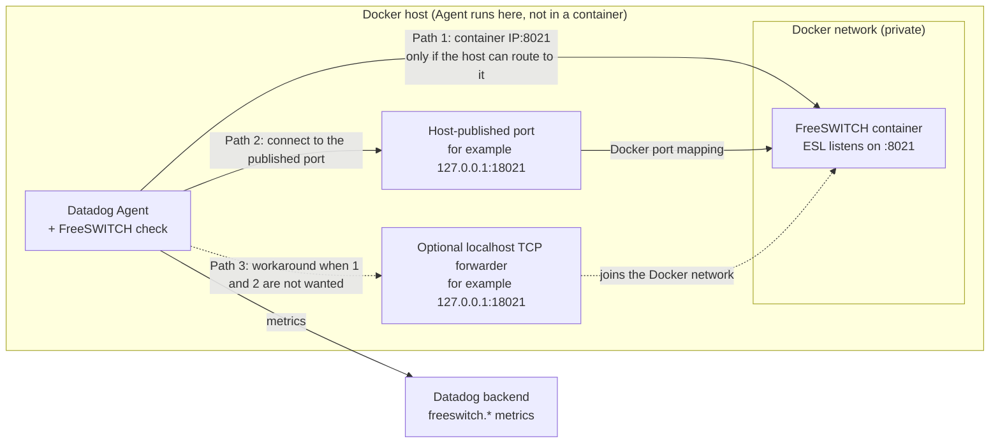
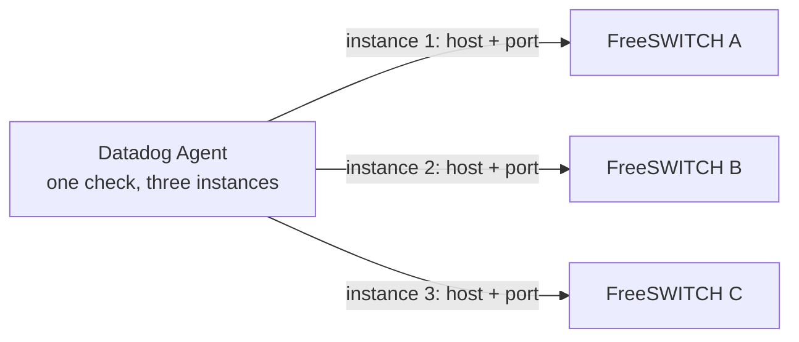

# Agent Check: FreeSWITCH

## Overview

This check monitors a [FreeSWITCH][1] server through the Datadog Agent. It connects to the FreeSWITCH Event Socket (ESL)
and reports the availability, uptime and channel count of the server.

The check only runs two read-only commands, `uptime s` and `show channels count`, and does not subscribe to events.

## Setup

Follow the instructions below to install and configure this check for an Agent running on a Linux host. For containerized
environments, see the [Autodiscovery integration templates][2] for guidance on applying these instructions.

### Requirements

- A Datadog Agent whose embedded Python is 3.13 or later (current Agent 7 releases), on Linux.
- FreeSWITCH with `mod_event_socket` enabled. Tested with FreeSWITCH 1.10.12.
- A network path from the Agent to the Event Socket port (default `8021`). The Event Socket is plain TCP: keep it on loopback
  or a private network and restrict it with an ACL.

### Installation

The FreeSWITCH check is not included in the [Datadog Agent][3] package. Install it as a community integration, following
[Use community integrations][4]:

```shell
sudo -u dd-agent -- datadog-agent integration install -t datadog-freeswitch==<VERSION>
```

To install a wheel that you built locally instead, run `sudo -u dd-agent -- datadog-agent integration install -w <PATH_TO_WHEEL>`.
Restart the Agent after installing.

### FreeSWITCH configuration

Use a dedicated directory user for the check rather than the shared Event Socket password. Add a file such as
`conf/directory/datadog.xml` (the domain name and secret below are placeholders):

```xml
<include>
  <domain name="monitoring.local">
    <users>
      <user id="datadog">
        <params>
          <param name="esl-password" value="<SECRET>"/>
          <param name="esl-allowed-api" value="uptime,show"/>
          <param name="esl-allowed-events" value=""/>
          <param name="esl-allowed-log" value="false"/>
        </params>
      </user>
    </users>
  </domain>
</include>
```

Then reload the directory with `fs_cli -x reloadxml`.

What this does and does not guarantee:

- When `username` is set, the check uses FreeSWITCH `userauth` and **refuses the account unless FreeSWITCH reports
  `Allowed-API` as exactly `uptime` and `show`**. An account with no `esl-allowed-api` (reported as `all`), or with extra
  commands, is rejected with `error_type:auth` before any command is sent. The check never falls back to the shared password.
- FreeSWITCH matches `esl-allowed-api` on the **first word** of a command only. `uptime,show` therefore allows every `uptime`
  and every `show` subcommand, not just `uptime s` and `show channels count`. `show` is read-only, but some subcommands
  list channel UUIDs and caller details. The check itself only ever sends the two commands above.
- Without `username`, the check authenticates with the shared Event Socket password. That password allows full control of
  FreeSWITCH, including running system commands, and the check cannot tell how it is limited.

### Configuration

1. Create `/etc/datadog-agent/conf.d/freeswitch.d/conf.yaml` (see the [sample freeswitch.d/conf.yaml][5] for all options):

   ```yaml
   init_config:

   instances:
     - host: 127.0.0.1
       port: 8021
       username: datadog@monitoring.local
       password: ENC[freeswitch_esl_password]
       connect_timeout: 3
       read_timeout: 3
       tags:
         - pbx:primary
   ```

2. Protect the password with the Agent's [secrets management][10] rather than writing it in plain text. For example, with the
   file backend, put `{"freeswitch_esl_password": "<SECRET>"}` in a file readable only by `dd-agent` and add this to `datadog.yaml`:

   ```yaml
   secret_backend_type: file.json
   secret_backend_config:
     file_path: /etc/datadog-agent/secrets.json
   ```

3. [Restart the Agent][6].

| Option | Required | Default | Notes |
|---|---|---|---|
| `host` | yes | | Use an IP address where possible (see below) |
| `port` | no | `8021` | |
| `username` | no | | `user@domain` for `userauth` |
| `password` | yes | | Shared password, or the user's `esl-password` when `username` is set |
| `connect_timeout` | no | `3` | Seconds, `0.1` to `30` |
| `read_timeout` | no | `3` | Seconds per response, `0.1` to `30` |
| `tags` | no | | Added to every metric |
| `min_collection_interval` | no | `15` | A run is capped at 90% of this value |

Each run makes one TCP connection (reused between runs) and two requests. A run's total time is limited to
`connect_timeout + 2 x read_timeout`, and to 90% of `min_collection_interval`.

**Host names.** An IP address is connected to directly. A host name is resolved by the operating system, which the check
cannot interrupt, so a slow DNS server can delay a run past the configured timeouts (the check does not connect after its deadline).
Use a host name only where DNS behavior is predictable, or use an IP address.

### Connection Architecture and Deployment Scenarios

The check opens one outbound TCP connection per instance from the Agent to the FreeSWITCH Event Socket and runs two read-only
commands. It only needs a `host` and `port` that the Agent process can reach. The `port` option selects the **destination**
port the check connects to; it does not configure FreeSWITCH. FreeSWITCH itself must be set to listen on that port
(`listen-port` in `event_socket.conf.xml`).

The diagram shows an Agent running directly on a Docker host. **Direct container IP, a host-published port, and a localhost TCP
forwarder are alternative paths: you need exactly one of them, not all three.**



#### Scenario A: FreeSWITCH installed natively on the Agent host

The Agent and FreeSWITCH run on the same machine. Use `host: 127.0.0.1` and the ESL port if the Event Socket listens on
loopback (or on an address that the Agent can reach). No Docker networking or forwarder is involved. Keep the
`apply-inbound-acl` setting restrictive so that only local clients are accepted.

#### Scenario B: FreeSWITCH in Docker, Agent on the Docker host

The Agent runs on the host, not in a container, so it has to reach the container from outside the Docker network. Choose one of:

- **Container IP and internal port (`host: <container IP>`, `port: 8021`).** This works only if the host can route to the
  container network and no firewall blocks it. On native Linux Docker the default bridge network is usually routable from the
  host. On **Docker Desktop for macOS or Windows**, containers run inside a virtual machine and container IPs are generally
  *not* reachable from the host, so do not assume this path works there. Container IPs also change when a container is recreated,
  unless you assign a fixed address on a user-defined network, so do not treat them as stable identifiers.
- **A container or service name.** Docker's DNS names (such as `my-freeswitch` or a Compose service name) resolve inside
  Docker networks. They are generally **not** resolvable from the host, so they only work as `host` when the Agent itself is on
  that Docker network or the name is resolvable through your own DNS or `/etc/hosts`.
- **A published port bound to a restricted host interface.** Publish the ESL port on loopback only, for example
  `-p 127.0.0.1:18021:8021` (Compose: `"127.0.0.1:18021:8021"`), and set `host: 127.0.0.1`, `port: 18021`. Do not publish ESL on
  `0.0.0.0` or a public interface unless access is restricted by a firewall and strong authentication.
- **A localhost TCP forwarder (optional workaround).** If you do not want to publish the ESL port on the container, a small
  forwarder that listens on `127.0.0.1:<port>` and relays to the container's port `8021` over the Docker network can bridge the
  gap. This is not required by the integration, and the forwarder becomes part of your monitoring path to maintain and secure.

Two things to check whichever path you choose:

- **Listener address.** The FreeSWITCH Event Socket must listen on an address that is reachable from outside the container's own
  loopback (`listen-ip` such as `0.0.0.0` or `::` *inside the container*). A container listening only on its own `127.0.0.1`
  cannot be reached through a published port.
- **ACL source address.** `apply-inbound-acl` is evaluated against the connection's source address as FreeSWITCH sees it. When
  traffic arrives through a published port or a forwarder, that is usually the Docker bridge gateway or the forwarder's container
  address, not `127.0.0.1`. If the check fails with `error_type:connect` right after the TCP connection opens, review the ACL.

See Docker's documentation on [publishing ports][11].

#### Scenario C: Multiple FreeSWITCH Docker containers

Each instance in `conf.yaml` is a separate connection with its own `host`, `port`, credentials and tags. Multiple containers
can all keep the same internal ESL port `8021`; a distinct host port is only needed when several containers are exposed through the
**same host IP address**, because one IP address and port can be bound only once.



*Example 1: directly reachable container IPs, each on internal port `8021`.* This only applies where the host can route to
the container network (see Scenario B).

```yaml
init_config:

instances:
  - host: 172.20.0.10
    port: 8021
    username: datadog@monitoring.local
    password: ENC[freeswitch_a_esl_password]
    tags:
      - pbx:a

  - host: 172.20.0.11
    port: 8021
    username: datadog@monitoring.local
    password: ENC[freeswitch_b_esl_password]
    tags:
      - pbx:b
```

*Example 2: different host-published ports through the Docker host.*

| FreeSWITCH container | Internal ESL port | Host-published port |
|---|---:|---:|
| FreeSWITCH A | 8021 | 18021 |
| FreeSWITCH B | 8021 | 18022 |
| FreeSWITCH C | 8021 | 18023 |

Publish each container on loopback, for example `-p 127.0.0.1:18022:8021` for FreeSWITCH B, then configure:

```yaml
init_config:

instances:
  - host: 127.0.0.1
    port: 18021
    username: datadog@monitoring.local
    password: ENC[freeswitch_a_esl_password]
    tags:
      - pbx:a

  - host: 127.0.0.1
    port: 18022
    username: datadog@monitoring.local
    password: ENC[freeswitch_b_esl_password]
    tags:
      - pbx:b

  - host: 127.0.0.1
    port: 18023
    username: datadog@monitoring.local
    password: ENC[freeswitch_c_esl_password]
    tags:
      - pbx:c
```

Every metric carries `freeswitch_host` and `freeswitch_port` tags (plus your `tags`), so instances remain distinguishable even
when they share `127.0.0.1`. The `username` must have the form `user@domain`. Use a separate secret per container if the
passwords differ.

#### Scenario D: Agent on a different host

The Agent needs a reachable private IP address or resolvable DNS name and the ESL port, with routing and firewall rules that
allow only the Agent's address to reach it. Also add that address to FreeSWITCH's `apply-inbound-acl`. The Event Socket is
unencrypted TCP, so use a private network or a tunnel you control, authenticate with the restricted `username` account described
above, and never expose ESL to the public internet.

### Validation

1. Check the loaded and (redacted) configuration:

   ```shell
   sudo -u dd-agent -- datadog-agent configcheck
   ```

   The password is shown as `********`.

2. Run the check once:

   ```shell
   sudo -u dd-agent -- datadog-agent check freeswitch
   ```

   Expect `freeswitch.can_connect` of `1`, `freeswitch.collection.errors` of `0`, and values for `freeswitch.uptime` and
   `freeswitch.channels.active`.

3. [Run the Agent's status subcommand][7] and look for `freeswitch` under the Checks section.

## Data collected

### Metrics

See [metadata.csv][8] for a list of metrics provided by this integration.

`freeswitch.channels.active` counts channels, not calls. A bridged call usually has two or more channels.

When a run fails, `freeswitch.can_connect` is `0`, `freeswitch.collection.errors` is `1` with an `error_type` tag, and no uptime or
channel value is reported for that run. `freeswitch.collection.duration` is always reported.

### Events

The FreeSWITCH integration does not include any events.

### Service checks

The FreeSWITCH integration does not include any service checks.

## Troubleshooting

Look at the Agent log for `FreeSWITCH collection on <host>:<port> failed`. The first failure and each change of error type is
logged as a warning; repeats of the same failure are logged at debug level, and recovery is logged at info level.

| `error_type` | Meaning | What to check |
|---|---|---|
| `connect` | Could not connect, the name did not resolve, or the server closed the connection | Host and port, firewall, FreeSWITCH is running, `mod_event_socket` is loaded, the Agent's address is allowed by the `apply-inbound-acl` ACL (FreeSWITCH closes the connection when it is not) |
| `timeout` | No complete response within the timeouts | Network latency or a stalled server; raise `read_timeout` modestly; check the FreeSWITCH load |
| `auth` | Authentication or permission was refused | Password and `username` (`user@domain`) are correct; for `userauth` accounts the `Allowed-API` must be exactly `uptime,show` (the log line says when the account is not restricted); the user's domain exists after `reloadxml` |
| `protocol` | The reply was not valid ESL, an unexpected type, or an error reply | The port is really the FreeSWITCH Event Socket; a proxy is not rewriting traffic |
| `parse` | A well-formed reply that is not the expected number | FreeSWITCH version differences; open an issue with the (non-sensitive) command output |

Need help? Open an issue on the [integrations-extras repository][9].

[1]: https://signalwire.com/freeswitch
[2]: https://docs.datadoghq.com/containers/kubernetes/integrations/
[3]: https://app.datadoghq.com/account/settings/agent/latest
[4]: https://docs.datadoghq.com/agent/guide/use-community-integrations/
[5]: https://github.com/DataDog/integrations-extras/blob/master/freeswitch/datadog_checks/freeswitch/data/conf.yaml.example
[6]: https://docs.datadoghq.com/agent/configuration/agent-commands/#start-stop-and-restart-the-agent
[7]: https://docs.datadoghq.com/agent/configuration/agent-commands/#agent-status-and-information
[8]: https://github.com/DataDog/integrations-extras/blob/master/freeswitch/metadata.csv
[9]: https://github.com/DataDog/integrations-extras/issues
[10]: https://docs.datadoghq.com/agent/configuration/secrets-management/
[11]: https://docs.docker.com/engine/network/port-publishing/
